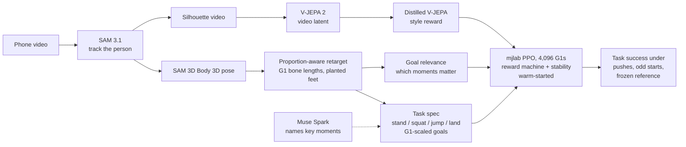

# athlete2humanoid

**A phone video of a person becomes a robust reinforcement-learning policy for the Unitree G1 humanoid, with no mocap and no motion library.** Meta's SAM 3.1 and SAM 3D Body turn the video into a 3D motion, the motion is rebuilt on the robot's own skeleton, Muse Spark names its key moments, and PPO in mjlab trains thousands of simulated G1s on it, with V-JEPA 2 as input, style term and judge.

Meta Global AI Developer Hackathon · track: *Push the Frontier* (robotics). Submission text: [`docs/SUBMISSION.md`](docs/SUBMISSION.md).

**Try it:** https://athlete2humanoid.pages.dev
- [`/build/latent_s3_kick`](https://athlete2humanoid.pages.dev/build/latent_s3_kick): the pipeline in 3D, one stage at a time, each stage labelled with the model that did it; push the trained policy at the end.
- [`/live`](https://athlete2humanoid.pages.dev/live): upload a clip and watch it build on the server (CPU, about 15–40 s; the API may take a moment to wake).
- [`/showcase`](https://athlete2humanoid.pages.dev/showcase): the trained policies in 3D. Click the robot to push it.

**Headline results** (each from the doc linked):
- **18 minutes, one GPU:** an unseen clip (the 1900 Olympic discus) became a policy that completes the throw on 100% of clean rollouts and 88% under 1 m/s pushes, warm-started from a 5-clip generalist. Two other unseen clips weren't learned in 30 minutes ([`FRONTIER_ADAPTATION`](docs/FRONTIER_ADAPTATION.md)).
- **Held-out variants:** squat jump 82% and front kick 100%, 0% falls ([`PIPELINE_ACCURACY`](docs/PIPELINE_ACCURACY.md), Fix 3).
- **Moves that travel:** the shot put glide from 0–8% to 100% task success ([`FRONTIER_TRAVEL`](docs/FRONTIER_TRAVEL.md)).
- **Muse Spark as a reward agent:** likeness to the video 0.410 vs 0.388 for an untouched control, for $0.10 of API, with its caveats ([`MUSE_AGENT`](docs/MUSE_AGENT.md)).
- **Honest negatives:** no zero-shot generalist at 328 motions (at most 7% on unseen variants), and V-JEPA 2's predictor is no world model for this ([`FRONTIER_GENERALIST`](docs/FRONTIER_GENERALIST.md), [`FRONTIER_WORLD_MODEL`](docs/FRONTIER_WORLD_MODEL.md)).

## Docs

**Results**, newest first:

| Doc | One line |
|---|---|
| [`FRONTIER_ADAPTATION.md`](docs/FRONTIER_ADAPTATION.md) | Minutes from a new clip to a robust policy, from scratch, a specialist and the generalist: 18 min for discus; punches and jumping jacks not reached. |
| [`FRONTIER_TRAVEL.md`](docs/FRONTIER_TRAVEL.md) | Why tracking policies stayed in place on travelling moves, and the reward and termination changes that make the shot put glide (0–8% → 100%). |
| [`FRONTIER_GENERALIST.md`](docs/FRONTIER_GENERALIST.md) | One tracker on 5 → 328 motions: zero-shot falls halve, zero-shot success stays at ≤7%. |
| [`FRONTIER_WORLD_MODEL.md`](docs/FRONTIER_WORLD_MODEL.md) | V-JEPA 2's predictor as a world model for the policy: worse than copying the present, and no help to the policy. |
| [`MUSE_AGENT.md`](docs/MUSE_AGENT.md) | Muse Spark live: naming key moments (10 clips, $0.086) and a tool-calling reward agent over training rounds, against a control. |
| [`PIPELINE_ACCURACY.md`](docs/PIPELINE_ACCURACY.md) | Stage-by-stage audit of where the athlete's motion is lost, and the seven fixes, including SAM 3D Body vs MediaPipe. |
| [`VJEPA_CONDITIONING.md`](docs/VJEPA_CONDITIONING.md) | The video's V-JEPA 2 latent as a policy input over five clips: 44% → 75% success with no future leakage. |
| [`PRO_CLIPS.md`](docs/PRO_CLIPS.md) | The stack on 1900 Olympic films (shot put, discus, hurdles): what transfers and what breaks. |
| [`GENERALIZATION.md`](docs/GENERALIZATION.md) | Tracking vs task policies, and training on automatic variants so a policy learns the action rather than the recording. |
| [`KEYPOSE_SPEC.md`](docs/KEYPOSE_SPEC.md) | Any clip as an RL task of ordered key moments, and the tuck-hop loophole Muse's critic caught. |
| [`GOAL_RELEVANCE.md`](docs/GOAL_RELEVANCE.md) | Physics attribution of which moments and body parts serve the goal; V-JEPA 2 masking tested as a second signal. |
| [`SEMANTIC_REWARD.md`](docs/SEMANTIC_REWARD.md) | Why a video-similarity reward alone was gamed, and the task-first reward that replaced it. |
| [`RETARGET.md`](docs/RETARGET.md) | Proportion-aware retargeting onto the G1: joint-angle error and foot sliding before and after. |
| [`PIPELINE_IMPROVEMENTS.md`](docs/PIPELINE_IMPROVEMENTS.md) | Commanded targets (one policy for a range of depths and heights) and further improvements by value and effort. |
| [`results/`](docs/results) | The raw tables behind the docs: squat-jump eval and robustness, adaptation curves, travel, generalist, pipeline audit. |

**Project:** [`SUBMISSION.md`](docs/SUBMISSION.md) (the submission text, by rubric criterion) · [`DEMO_SCRIPT.md`](docs/DEMO_SCRIPT.md) (the 3-minute video and the live demo) · [`META_INTEGRATION.md`](docs/META_INTEGRATION.md) (Meta Model API: plan and what was verified live).

**Running it:** [`SYSTEM_DESIGN.md`](docs/SYSTEM_DESIGN.md) · [`DEPLOY.md`](docs/DEPLOY.md) · [`SECURITY.md`](docs/SECURITY.md) · [`MODAL.md`](docs/MODAL.md) · [`FARMSHARE.md`](docs/FARMSHARE.md) · [`USER_TODO.md`](docs/USER_TODO.md).

## Why

Humanoids learn new skills from motion capture or hand-written rewards. Both are slow and expensive, and neither scales to the thousands of moves people film every day. We want a robot to learn a skill from an ordinary phone video: no mocap suit, no markers, no reward engineering.

Copying a video frame by frame is brittle. Monocular pose is noisy, human and robot bodies differ, and a policy that copies the clip needs the clip: change the start, shove it, or take the reference away and it has nothing to fall back on. So we read off **what the action is** (its stages and their goals, in the robot's own proportions) and reward the robot for achieving that. Looking like the video, measured by Meta's V-JEPA 2, becomes a light style term.

## How it works



1. **Track.** SAM 3.1 segments the person from a text prompt and keeps the main track ([`track.py`](track.py), [`sam_track.py`](sam_track.py)).
2. **Retarget, in the robot's proportions.** The 3D pose (SAM 3D Body on a GPU, MediaPipe otherwise; [`frontends/`](frontends/), fix 3 in [`docs/PIPELINE_ACCURACY.md`](docs/PIPELINE_ACCURACY.md)) is rebuilt on the G1's own bone lengths with the person's bone directions, so joint angles carry over, and planted feet stay pinned. Joint-angle error is 3–10× lower than uniform scaling and foot sliding drops from 29 to 0.4 cm/s ([`retarget.py`](retarget.py), [`docs/RETARGET.md`](docs/RETARGET.md)).
3. **Read off the action.** The retarget's kinematics become an ordered **task spec**: stand → squat → jump → land → stand, with goals in G1 units (squat depth, jump clearance clipped to what the G1 can do). Muse's skill spec names the stages and is cross-checked ([`skill/task.py`](skill/task.py), [`docs/SEMANTIC_REWARD.md`](docs/SEMANTIC_REWARD.md)).
4. **Reward the action.** A batched reward machine pays potential-based progress toward the current stage, a bonus when it's done (for a jump, scaled by a target height band) and a finish bonus, all gated on staying upright. The stage is part of the policy's observation. Timing and poses are free.
5. **Look like the video, where it matters.** V-JEPA 2's latent, distilled into a fast reward net, is a weak style term, weighted in time by **goal relevance**: physics attribution of which moments and body parts change the outcome (the push before takeoff, the landing; not arm-waving for the crowd) ([`skill/importance.py`](skill/importance.py), [`docs/GOAL_RELEVANCE.md`](docs/GOAL_RELEVANCE.md)).
6. **Stay up.** Stability terms (alive bonus, fall penalty, clip-relative fall termination, foot slip, push curriculum) and episodes that end only on a fall, never for leaving the retarget ([`mjlab_tasks.py`](mjlab_tasks.py)).
7. **Train, building on what's there.** mjlab PPO on one A100, every policy warm-started from saved weights; a task policy whose inputs grew starts out acting exactly like its source ([`policy_weights.py`](policy_weights.py), [`scripts/weights.py`](scripts/weights.py)).
8. **Test the claim.** 64 rollouts per condition, 18 conditions: random and stage-timed pushes, noisy and unusual starts, friction and mass, tempo, and the reference frozen ([`experiments/robustness_eval.py`](experiments/robustness_eval.py)).

Policies on the same clip:
- **tracking**: mjlab's standard motion-imitation reward (copy the retarget). The baseline.
- **task**: the task reward leads; the policy still sees the retarget, with a 0.1× tracking style term.
- **taskphase**: the task reward, and the policy never sees the retarget, only its own body, a clock and the current stage.

## Meta models

| Model | Role | Measured |
|---|---|---|
| **SAM 3.1** (`facebook/sam3.1`, open weights) | Text-prompted video tracking of the person; its masks crop the frame for pose and become the silhouette V-JEPA 2 embeds | Finds the 1900 hurdler that whole-frame pose misses in every frame ([`PIPELINE_ACCURACY`](docs/PIPELINE_ACCURACY.md), Stage 1) |
| **SAM 3D Body** (`facebook/sam-3d-body-dinov3`, open weights) | 3D pose of the masked athlete (MediaPipe is the CPU fallback) | Bone-length variation 3–6x lower on phone clips ([`PIPELINE_ACCURACY`](docs/PIPELINE_ACCURACY.md), Fix 3) |
| **V-JEPA 2** (`facebook/vjepa2-vitl-fpc64-256`, open weights) | The video's latent as a policy input, a weak style reward, and the likeness judge | 44% → 75% success over five clips as a past-only input ([`VJEPA_CONDITIONING`](docs/VJEPA_CONDITIONING.md)) |
| **Muse Spark** (`muse-spark-1.3`, Meta Model API) | Names each key moment from the video (`muse_label`); a tool-calling reward agent between training rounds; a blind rollout critic | 10/10 clips named for $0.086; agent likeness 0.410 vs 0.388 for the control ([`MUSE_AGENT`](docs/MUSE_AGENT.md)) |

## Results

### Squat jump (final run)

Target: one phone video of two squat jumps. Three policies, 1,200 PPO iterations × 4,096 envs each on one A100 (about 1.5 h), warm-started (tracking from the squat tracking policy, task from the squat hybrid policy, taskphase from an earlier squat-jump run). Evaluation rollout from the start of the clip ([`docs/results/squat_jump_eval.md`](docs/results/squat_jump_eval.md)):

| Robot motion | Task stages | Falls | Jump quality | Joint error vs clip | Torso distance vs clip | V-JEPA cosine to video |
|---|---|---|---|---|---|---|
| Retarget (kinematic) | 9/9 | n/a | 1.00 / 1.00 | n/a | n/a | 0.732 |
| Tracking | 9/9 | 0 | 0.87 / 0.86 | 0.11 rad | 0.11 m | **0.696** |
| Task | 9/9 | 0 | 0.51 / 0.68 | 0.42 rad | 0.41 m | 0.431 |
| Task, no reference | 9/9 | 0 | 0.79 / 1.00 | 0.42 rad | 1.06 m | 0.312 |

**Robustness** (64 rollouts per condition; success = every stage in order, no fall; [`docs/results/squat_jump_robustness.md`](docs/results/squat_jump_robustness.md)):

| Policy | Clean | Random pushes | Push 1.5 m/s | Start noise | Start pose | Tempo | Friction/mass | **Reference frozen** | Joint DTW to clip |
|---|---|---|---|---|---|---|---|---|---|
| Tracking | 100% | 65% | 14% | 54% | 100% | 97% | 100% | **0%** | 0.10 |
| Task | 100% | **94%** | **81%** | **83%** | 100% | 100% | 99% | **100%** | 0.41 |
| Task, no reference | 100% | 83% | 55% | 73% | 80% | 100% | 98% | **100%** | 0.41 |

**What this shows.** Every policy can do the squat jump as trained. Take the reference away and the clip-copier just stands there (0%), while both task policies still squat, jump, land and stand (100%). Under shoves and noisy starts the task policy succeeds far more often than tracking (94% vs 65% under random pushes, 81% vs 14% at 1.5 m/s). And they do it their own way: joint-space distance to the clip is 0.41 rad, more than standing still scores (0.17). The price is style: they look less like the video (V-JEPA 0.43 / 0.31 vs 0.70), because style is deliberately a weak term.

### How we got here (squat clip)

| Run | Policy | V-JEPA cosine (time-aligned) | Falls | Note |
|---|---|---|---|---|
| v1 | Tracking | **0.714** | 0 | |
| v1 | Hybrid (latent + 1/5 tracking) | 0.579 | 0 | |
| v1 | Latent-only | 0.532 | 0 | barely above the closest wrong bank motion (`bend`, 0.518 DTW) |
| v2 (DAgger reward net) | Hybrid | 0.585 | 0 | reward net held-out cosine 0.62 → 0.80 |
| v2 (DAgger reward net) | Latent-only | 0.527 | 0 | the policy gamed the learned reward |

- **A video-similarity reward alone wasn't enough.** V-JEPA cosine barely separates "the action" from "a person moving" (almost every humanoid motion scores ~0.5), and in v2 the distilled reward rose (0.35 → 0.49) while real V-JEPA stayed flat (0.35 → 0.37): reward hacking. Yet all five squat policies completed the squat under the semantic spec (5/5 stages): the metric, not the policies, was the problem.
- **The first squat-jump task run plateaued** (episodes ~60 of 500 steps, most ending in falls) without stability terms or a warm start. CPU rollouts then showed the robot over-jumping and collapsing on landing, because the jump paid before the landing. Now a fall refunds the attempt (commit 883c6b7, after the final run trained).

Earlier V-JEPA 2 probes: [`RESEARCH.md`](RESEARCH.md) and [`experiments/cross_embodiment_probe.py`](experiments/cross_embodiment_probe.py).

## Quickstart

**Local (CPU, robot parts only).** This runs pose, retargeting and rendering without SAM.
```bash
pip install -r requirements.txt
bash scripts/fetch_assets.sh                      # G1 from MuJoCo Menagerie, MediaPipe model
python retarget.py                                # synthetic squat: outputs/g1_ik_squat.mp4
python pipeline.py clips/squat.mp4 --no-sam       # outputs/squat/{motion.csv, side_by_side.mp4}
```

**Colab A100, unattended from your laptop** ([`scripts/remote_run.py`](scripts/remote_run.py)). You need the `colab` CLI logged in (oauth2) and a Hugging Face token with access to `facebook/sam3.1`, set as `HF_TOKEN` in `.env` (see `.env.example`). Name each clip after its action (`clips/squat.mov`); the target is the clip's file name.
```bash
python3 scripts/remote_run.py latent --smoke                                  # plumbing test, no clips, minutes
python3 scripts/remote_run.py latent --target squat --min-clips 7 --iters 2000 # first run: SAM, reward net, policies
```
It waits for the clips, checks the token, creates an A100, clones this repo from GitHub (so push first), runs SAM, distillation, three trainings and the evaluation, then downloads `results.tar.gz` to `outputs/remote_latent/` and stops the VM.

**Saved weights: build off them instead of retraining** ([`scripts/weights.py`](scripts/weights.py), [`policy_weights.py`](policy_weights.py)).

- **What's kept automatically**
  - Every training saves a checkpoint every 250 iterations, plus `weights.json` recording what the policy was trained from.
  - Remote runs pull the latest checkpoints back about every 10 minutes. If the VM is lost, the retry continues from there instead of starting over.
- **How to start from saved weights**
  - `--init` starts from another policy's weights, even one from another task. A policy whose observations grew starts out acting exactly like its source.
  - `--resume-from` continues the same task for more iterations.

```bash
python scripts/weights.py list                                         # every trained policy + scores
python scripts/weights.py keep remote_latent_v2 hybrid --name v2_hybrid  # -> weights/v2_hybrid/
python3 scripts/remote_run.py latent --reuse outputs/remote_latent_v2 --with-weights \
    --args "--reward /content/a2h/inputs/reward.pt --policies task --init /content/a2h/inputs"   # Task <- Hybrid
```

**The final squat-jump run** (reuses the processed clips and reward net, warm-starts every policy):
```bash
python3 scripts/remote_run.py latent --tag final --target squat_jump --reuse outputs/reuse_final --with-weights --iters 1200 \
    --args "--reward /content/a2h/inputs/reward.pt --policies tracking task taskphase --init /content/a2h/inputs \
            --importance /content/a2h/inputs/clips/squat_jump/importance.json"
python3 scripts/remote_run.py robust --reuse outputs/remote_latent_final --target squat_jump --tag final
```
`--backend farmshare` runs the same jobs on Stanford FarmShare through Slurm ([`docs/FARMSHARE.md`](docs/FARMSHARE.md)).

**Web app** ([`docs/DEPLOY.md`](docs/DEPLOY.md)): `make install && make dev`, then http://localhost:5173. The `/examples` page works with no backend.

**Colab notebook, interactive:** [`notebooks/video_to_policy.ipynb`](notebooks/video_to_policy.ipynb) on an L4 or A100 (SAM 3.1 needs more than a T4) covers clip → SAM → retarget → tracking policy.

## Repo map

| Path | What it does |
|---|---|
| [`pipeline.py`](pipeline.py) | Video to G1 motion CSV + side-by-side preview |
| [`track.py`](track.py), [`sam_track.py`](sam_track.py) | SAM 3.1 tracking (its own Python 3.12 env, since sam3 pins `numpy<2`) |
| [`frontends/`](frontends/), [`pose.py`](pose.py), [`retarget.py`](retarget.py) | 3D pose (SAM 3D Body, MediaPipe fallback); proportion-aware mink IK onto the G1, mjlab CSV export |
| [`skill/`](skill) | Task spec + reward machine (`task.py`), goal relevance (`importance.py`), commanded targets (`commands.py`) |
| [`latent/`](latent) | Silhouettes, V-JEPA 2 wrapper and predictor diagnostic, motion bank, distillation, reward net |
| [`mjlab_tasks.py`](mjlab_tasks.py) | A2H tasks: Hybrid, Latent, LatentPhase, Task, TaskPhase, TaskCmd; stability terms |
| [`train_motion.py`](train_motion.py), [`mjlab_rollout.py`](mjlab_rollout.py), [`policy_weights.py`](policy_weights.py) | CSV to PPO policy (resume / warm start), headless rollout |
| [`muse/`](muse) | Muse Spark client, moment namer, reward agent loop, rollout critic ([`docs/MUSE_AGENT.md`](docs/MUSE_AGENT.md)) |
| [`experiments/`](experiments) | End-to-end run, robustness eval, goal relevance, command eval, V-JEPA probes |
| [`scripts/`](scripts) | Colab / FarmShare runners, weights registry, demo assets, examples, Space build |
| [`server/`](server), [`web/`](web) | FastAPI backend and React frontend ([`docs/DEPLOY.md`](docs/DEPLOY.md), [`docs/SECURITY.md`](docs/SECURITY.md), [`docs/SYSTEM_DESIGN.md`](docs/SYSTEM_DESIGN.md)) |

## Limitations

- **Not every move is learned yet.** Policies have been trained on all ten clips, but the lunge fails for every policy at a 0.32 m forward weight shift ([`docs/FRONTIER_TRAVEL.md`](docs/FRONTIER_TRAVEL.md)), punches and jumping jacks weren't learned in 30 minutes of adaptation ([`docs/FRONTIER_ADAPTATION.md`](docs/FRONTIER_ADAPTATION.md)), and with no per-clip training a generalist reaches at most 7% on unseen variants ([`docs/FRONTIER_GENERALIST.md`](docs/FRONTIER_GENERALIST.md)).
- **The squat-jump tables below are the first final run.** Its task policies were later found to be tuck-hopping and were retrained on a stricter spec ([`docs/KEYPOSE_SPEC.md`](docs/KEYPOSE_SPEC.md)), so their robustness numbers flatter them.
- **Success vs style.** The task policies look less like the video (V-JEPA 0.43 / 0.31 vs 0.70 for tracking). Style is deliberately weak; stronger, goal-weighted style is the next lever.
- **The final run trained before the landing fix** (fall refund, 883c6b7) and the grounded start states; its jump quality has room to improve.
- **The Muse reward agent is one run per arm** on one clip; its likeness gain is from upweighting the likeness terms, and seed variance is unmeasured ([`docs/MUSE_AGENT.md`](docs/MUSE_AGENT.md)).
- **Goal relevance is physics-based.** V-JEPA 2 predictor masking was tested as a second signal and didn't pick out goal-relevant motion, so it's kept as a diagnostic.
- **Simulation only**, no sim-to-real transfer yet; a single camera viewpoint and monocular depth ambiguity remain.

## Next steps

1. Commanded targets (`A2H-TaskCmd`, implemented): one policy for a range of squat depths and jump heights, under a curriculum.
2. Live Muse: skill reader on new videos, and the reward-design agent closing the loop on real runs.
3. More actions (lunge, kick, jumping jacks) and several videos of the same action into one policy.
4. Sim-to-real on a physical G1: domain randomisation ranges, latency, ONNX export ([`docs/PIPELINE_IMPROVEMENTS.md`](docs/PIPELINE_IMPROVEMENTS.md)).

## Credits

Built on [SAM 3](https://github.com/facebookresearch/sam3), [V-JEPA 2](https://github.com/facebookresearch/vjepa2), [MuJoCo](https://mujoco.org) and [Menagerie](https://github.com/google-deepmind/mujoco_menagerie), [mjlab](https://github.com/mujocolab/mjlab), [mink](https://github.com/kevinzakka/mink) and [MediaPipe](https://ai.google.dev/edge/mediapipe).
