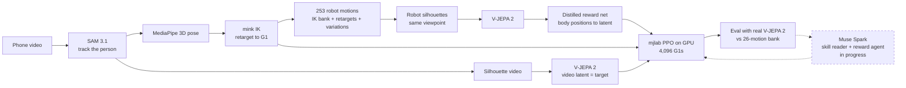

# athlete2humanoid

**Any video of a person moving becomes a physics RL policy for the Unitree G1 humanoid, trained to look like the move in the video rather than only copy its joint angles.**

Meta Global AI Developer Hackathon · track: *Push the Frontier* (robotics).

<!-- TODO(v2): demo GIF or MP4 (video | tracking policy | latent policy, side by side). -->
<!--  -->
> **Demo:** TODO(v2): add the demo GIF/MP4 and video link.

## Why

Humanoids learn new skills from motion capture or hand-written rewards. Both are slow and expensive, and neither scales to the thousands of moves people film every day. We want a robot to learn a skill from an ordinary phone video: no mocap suit, no markers, no reward engineering.

Copying a video frame by frame is brittle. Monocular pose is noisy, human and robot bodies differ, and an exact copy can't adapt. So we also give the policy a reward for *what the motion looks like*, measured by Meta's video world model V-JEPA 2. That is the first step towards a policy that learns the action, not the clip.

## How it works



1. **Track.** SAM 3.1 segments the person from a text prompt ("athlete", falling back to "person") and keeps the main track. Masks give clean crops for pose and a silhouette video for V-JEPA ([`track.py`](track.py), [`sam_track.py`](sam_track.py)).
2. **Retarget.** MediaPipe 3D pose plus 2D root motion gives a metric human trajectory. mink IK maps feet, knees, pelvis, elbows, hands and torso orientation onto the G1 and exports an mjlab motion CSV ([`pose.py`](pose.py), [`retarget.py`](retarget.py), [`pipeline.py`](pipeline.py)).
3. **Embed.** Human and robot are both rendered as white-on-black silhouettes at the same scale and camera angle, so V-JEPA 2 compares motion rather than appearance. Each domain is centred on its own mean embedding ([`latent/silhouette.py`](latent/silhouette.py), [`latent/vjepa.py`](latent/vjepa.py)).
4. **Distil.** V-JEPA is far too slow to run inside RL (4,096 robots at 50 Hz). We render 253 robot motions (26 IK bank motions, the 7 clip retargets and 220 randomised variations: speed changes, mixed bodies, noise, leaning, falling, freezing) and train a small MLP that maps ~1 s of G1 body positions to V-JEPA's latent, projected to 64 principal components ([`latent/distill.py`](latent/distill.py), [`latent/reward_net.py`](latent/reward_net.py)).
5. **Train.** Three mjlab PPO policies on the same clip ([`mjlab_tasks.py`](mjlab_tasks.py), [`train_motion.py`](train_motion.py)):
   - **tracking**: mjlab's standard motion-tracking reward (copy the retarget);
   - **hybrid**: latent reward plus tracking at 1/5 weight, with relaxed terminations;
   - **latent-only**: latent reward only, with the same relaxed terminations. The retarget is still an observation and a reset state, but it is never scored.
6. **Evaluate.** Each rollout is re-rendered and scored with the *real* V-JEPA 2, not the distilled net. We report time-aligned cosine to the video, and DTW rank against all 26 bank motions ([`experiments/latent_policy.py`](experiments/latent_policy.py)).

## Meta models

| Model | Role | Why this model |
|---|---|---|
| **SAM 3.1** (`facebook/sam3.1`, open weights) | Text-prompted video tracking of the person | Gives one consistent identity across the clip with no clicks. The masks feed both pose and the silhouette latent, so SAM is in the reward path, not only preprocessing. |
| **V-JEPA 2** (`facebook/vjepa2-vitl-fpc64-256`) | Motion embedding that becomes the reward target | Self-supervised video world model. On silhouettes it separates actions by motion and is robust to timing: a fast 3-rep squat is still the closest match to a slow one. Our probe found the human clip's own retarget ranked #1 by DTW for 6 of 7 clips. |
| **Muse Spark** (Meta Model API) *(in progress)* | **Skill reader:** video to a strict-JSON training spec (phases, what matters). **Reward-design agent:** watches the comparison video, reads the real-V-JEPA metrics, edits reward weights and terminations, retrains. | Takes video natively and supports tool calling and strict schemas. The agent is scored by real V-JEPA, so it can't game the distilled reward net. |

## Results

Target: one human squat clip (phone video). One A100, three policies trained in parallel, 2,000 PPO iterations × 4,096 envs each, about 2.3 h.

| Robot motion | V-JEPA cosine to video (time-aligned) | DTW rank vs 26 bank motions | Falls | Torso error (mean) | Uses tracking reward |
|---|---|---|---|---|---|
| Retarget (kinematic, no physics) | 0.726 | #1 | n/a | n/a | n/a |
| Tracking policy | **0.714** | #1 | 0 | 7.1 cm | yes |
| Hybrid policy | 0.579 | #1 | 0 | 13.3 cm | 1/5 weight |
| Latent-only policy | 0.532 | #1 | 0 | 16.6 cm | **no** |
| Hybrid, DAgger reward net | TODO(v2) | TODO(v2) | TODO(v2) | TODO(v2) | 1/5 weight |
| Latent-only, DAgger reward net | TODO(v2) | TODO(v2) | TODO(v2) | TODO(v2) | **no** |

Reward net: distilled from 253 motions (14,785 windows), 0.62 mean cosine on 25 held-out motions (10th percentile 0.31). TODO(v2): DAgger reward net held-out cosine.

**What this shows.** A policy rewarded only by a video embedding learned a stable, recognisable squat: it never fell, and real V-JEPA ranks it closer to the video than every bank motion. It does not yet match tracking: tracking stays best on every metric, and the latent policy's DTW margin over the closest bank motion is small (0.549 vs 0.518, `bend`). The likely cause is the reward net: it was trained on IK motions, not on the states a policy actually visits during RL. The DAgger run, now training, adds the policies' own rollouts to its training set.

Earlier V-JEPA 2 probes: [`RESEARCH.md`](RESEARCH.md) (synthetic, same-vs-different margin +0.647) and [`experiments/cross_embodiment_probe.py`](experiments/cross_embodiment_probe.py) (human video vs robot, 7 clips).

## Quickstart

**Local (CPU, robot parts only).** This runs pose, retargeting and rendering without SAM.
```bash
pip install -r requirements.txt
bash scripts/fetch_assets.sh                      # G1 from MuJoCo Menagerie, MediaPipe model
python retarget.py                                # synthetic squat: outputs/g1_ik_squat.mp4
python pipeline.py clips/squat.mp4 --no-sam       # outputs/squat/{motion.csv, side_by_side.mp4}
```

**Colab A100, unattended from your laptop** ([`scripts/remote_run.py`](scripts/remote_run.py)). You need the `colab` CLI logged in (oauth2) and a Hugging Face token with access to `facebook/sam3.1`, set as `HF_TOKEN` in `.env` (see `.env.example`). Name each clip after its action (`clips/squat.mov`); the target is the clip's file name.
```bash
python3 scripts/remote_run.py latent --smoke                                  # plumbing test, no clips, minutes
python3 scripts/remote_run.py latent --target squat --min-clips 7 --iters 2000 # the run above
```
It waits for the clips, checks the token, creates an A100, clones this repo from GitHub (so push first), runs SAM, distillation, three trainings and the evaluation, then downloads `results.tar.gz` to `outputs/remote_latent/` and stops the VM.

**Saved weights: build off them instead of retraining** ([`scripts/weights.py`](scripts/weights.py), [`policy_weights.py`](policy_weights.py)).

- **What's kept automatically**
  - Every training saves a checkpoint every 250 iterations, plus `weights.json` recording what the policy was trained from.
  - Remote runs pull the latest checkpoints back about every 10 minutes. If the VM is lost, the retry continues from there instead of starting over.
- **How to start from saved weights**
  - `--init` starts from another policy's weights, even one from another task. A policy whose observations grew starts out acting exactly like its source.
  - `--resume-from` continues the same task for more iterations.

```bash
python scripts/weights.py list                                         # every trained policy + scores
python scripts/weights.py keep remote_latent_v2 hybrid --name v2_hybrid  # -> weights/v2_hybrid/
python3 scripts/remote_run.py latent --reuse outputs/remote_latent_v2 --with-weights \
    --args "--reward /content/a2h/inputs/reward.pt --policies task --init /content/a2h/inputs"   # Task <- Hybrid
```

**Colab notebook, interactive:** [`notebooks/video_to_policy.ipynb`](notebooks/video_to_policy.ipynb) on an L4 or A100 (SAM 3.1 needs more than a T4) covers clip → SAM → retarget → tracking policy.

## Repo map

| Path | What it does |
|---|---|
| [`pipeline.py`](pipeline.py) | Video to G1 motion CSV + side-by-side preview |
| [`track.py`](track.py), [`sam_track.py`](sam_track.py) | SAM 3.1 tracking (runs in its own Python 3.12 env, since sam3 pins `numpy<2`) |
| [`pose.py`](pose.py) | MediaPipe 3D pose to a metric, z-up human trajectory |
| [`retarget.py`](retarget.py) | mink IK onto the G1, error report, mjlab CSV export |
| [`latent/`](latent) | Silhouettes, V-JEPA 2 wrapper, 26-motion IK bank, distillation, reward net |
| [`mjlab_tasks.py`](mjlab_tasks.py) | `A2H-Hybrid-…` and `A2H-Latent-Flat-Unitree-G1` tasks with the latent reward |
| [`train_motion.py`](train_motion.py), [`mjlab_rollout.py`](mjlab_rollout.py) | CSV to PPO policy, headless rollout video + metrics |
| [`experiments/`](experiments) | V-JEPA probes and the end-to-end latent-policy experiment |
| [`scripts/`](scripts) | Asset fetch, Colab setup, unattended remote runner |
| [`coach.py`](coach.py) | Muse Spark client (Meta Model API, OpenAI-compatible) |
| [`PLAN.md`](PLAN.md), [`RESEARCH.md`](RESEARCH.md) | Plan, prior art, probe results |

## Limitations

- **One clip, one move.** Results are for a single squat video. Six more clips are processed but haven't been trained on.
- **Latent-only is below tracking**, at 0.53 vs 0.71 cosine. The distilled reward net is the bottleneck: its held-out cosine is 0.62, and the trained policies score lower in its space than the retarget does.
- **"Learns the action, not the clip" is the goal, not yet a measured result.** We haven't yet tested on variations the clip never showed (deeper squats, pushes, different heights).
- **The latent policy still sees the retarget** as its observation and reset state. It just isn't rewarded for matching it.
- **Single viewpoint.** The robot is rendered from the video's estimated camera azimuth, and depth ambiguity in monocular video remains.
- **Simulation only**, with no sim-to-real transfer yet. The arm-raise clip fails the cross-embodiment probe: its own retarget ranks 20th of 27 by DTW.

## Next steps

1. DAgger-refined reward net (training now): TODO(v2) results.
2. Muse Spark skill reader and reward-design agent loop (in progress on `claude/meta-tooling-plan-c004aa`).
3. Train the other six clips (lunge, front kick, jumping jacks, punches, squat jump, arms).
4. Generalisation tests: unseen depths and heights, push recovery.
5. Open-weights rollout critic (Muse Glimmer), and sim-to-real on a physical G1.

## Credits

Built on [SAM 3](https://github.com/facebookresearch/sam3), [V-JEPA 2](https://github.com/facebookresearch/vjepa2), [MuJoCo](https://mujoco.org) and [Menagerie](https://github.com/google-deepmind/mujoco_menagerie), [mjlab](https://github.com/mujocolab/mjlab), [mink](https://github.com/kevinzakka/mink) and [MediaPipe](https://ai.google.dev/edge/mediapipe).
