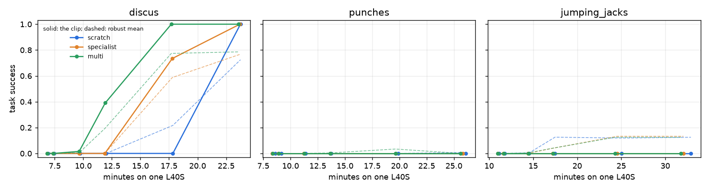

# Fast adaptation: how fast does a new skill become a robust policy?

**Question:** given a clip no policy has trained on, how many minutes of PPO does it take to get a policy that does the move, and keeps doing it when pushed, re-timed or varied? And how much does the starting point matter?

**Answer:** on the one clip where any start passed, **a new athletic skill took 18 minutes on one L40S from the 5-clip generalist**: 1,000 PPO iterations, 12 of the minutes training and 6 building the clip's variants. From scratch it took 24 minutes (1,500 iterations). On the other two clips, 1,500 iterations (about half an hour) were not enough for any start:
- **punches:** tracked closely but short of the checker;
- **jumping jacks:** the robot never left the ground for the jump.

So "N minutes" holds only for some moves. The starting point helps where the move is learnable, and does not rescue a move that is not.

## Setup

`experiments/adaptation_curves.py`; results in `outputs/remote_adapt_v2_{discus,jumping_jacks,punches}`.

**Clips:** the zero-shot test set shared by the four frontier directions: jumping jacks, punches, and the 1900 Olympic discus. None of the starting policies trained on any of them. Each was re-retargeted from its `human.npy` with the current `retarget.py` (commit 42f3d64's joint-speed cap and gravity check on flights):

| Clip | Fastest joint before | After |
|---|---|---|
| jumping jacks | 76 rad/s (overhead arm flips) | 20 rad/s |
| discus | 65 rad/s | 20 rad/s |
| punches | 10 rad/s | 10 rad/s (unchanged) |

**Three starting points**, all in the same task (`A2H-Tracking-Flat-Unitree-G1`), differing only in their initial weights:

| Start | Weights |
|---|---|
| `scratch` | a fresh tracking policy |
| `specialist` | the squat-jump tracker trained on variants (`tracking_var`, 1,500 iterations) |
| `multi` | the 5-clip generalist (`multi`, 2,000 iterations on squat jump, front kick, squat, arms and lunge) |

**Training:** for each clip and start, 1,500 PPO iterations on the clip's automatic variants (`skill/variations.py`: mirror × 3 tempos × 3 amplitudes × 2 warps, those within joint limits), 4,096 environments, a checkpoint every 50 iterations. The three starts train one after another on one GPU, so each run has the GPU to itself and its minutes are what one new clip costs.

**Test at 50, 100, 300, 500, 1,000 and 1,500 iterations** (`experiments/robustness_eval.py`, 64 rollouts per condition):
- the clip itself;
- its held-out variants (tempos and amplitudes outside the training range, the mirror image at other tempos, a stronger warp);
- 1 m/s pushes;
- 0.5x and 2x tempo.

At 1,500 iterations, every mjlab suite: pushes of 0.5–1.5 m/s, stage-timed pushes, start noise, start poses, friction and mass, 0.8x / 1.2x speed, 0.5x–2x tempo, no reference.

**Minutes** = building the variants + the trainer's start-up + PPO time to that iteration (the trainer's own clock), on one L40S. They exclude the clip's processing (SAM 3.1, pose, retarget), which is the same for every start.

**Task success** is the keypose spec's (`skill/keypose.py`): every key moment, in order, with no fall. "Robust" below is task success averaged over the four short-set conditions.

## Results

Full tables: [`results/adaptation/adaptation_curves.md`](results/adaptation/adaptation_curves.md) (and `.json`). All runs were on an NVIDIA L40S (`gpu.txt`). **Jumping jacks is partial:** its curve (all six test points, short set) is complete, but the Modal workspace hit its spend limit during the full suite at 1,500 iterations, so it has no full-suite row.



### Minutes to doing the move

Task success on the clean clip, first test point at or above the threshold (minutes include the variant build):

| Clip | Start | 50% | 90% | Clip, variants, 1 m/s pushes and tempo averaged ≥ 80% |
|---|---|---|---|---|
| discus | scratch | 24 min (1,500 it) | 24 min (1,500 it) | not reached (73% at 1,500) |
| discus | specialist | 18 min (1,000 it) | 24 min (1,500 it) | not reached (77%) |
| discus | **multi** | **18 min (1,000 it)** | **18 min (1,000 it)** | not reached (78% at 1,000) |
| punches | all three | not reached | not reached | not reached |
| jumping jacks | all three | not reached | not reached | not reached |

The averaged column is capped by tempo: at 2x every discus policy falls every time, so the tempo suite tops out at 50%.

Where the minutes go, per start and clip:

| | discus | punches | jumping jacks |
|---|---|---|---|
| building the variants (once per clip) | 5.9 min | 7.5 min | 9.8 min |
| trainer start-up | 0.4 min | 0.4 min | 0.6 min |
| PPO, 1,000 iterations | 11.5 min | 11.8 min | 14.3 min |
| PPO, 1,500 iterations | 17.4 min | 18.0 min | 22.0 min |

The build is a third of the 18 minutes. It is the same for every start, so it could be shared or cached.

### Discus: the starting point matters

| Start | Iterations | Minutes | The clip | Held-out variants | Pushed 1 m/s | Tempo 0.5x / 2x | Joint error (rad) |
|---|---|---|---|---|---|---|---|
| scratch | 500 | 12 | 0% (100%) | 0% (100%) | 0% (100%) | 0% (100%) | 0.324 |
| scratch | 1,000 | 18 | 0% (0%) | 45% (25%) | 27% (6%) | 15% (85%) | 0.327 |
| scratch | 1,500 | 24 | 100% (0%) | 80% (0%) | 61% (11%) | 49% (51%) | 0.287 |
| specialist | 500 | 12 | 0% (100%) | 0% (100%) | 0% (100%) | 0% (100%) | 0.280 |
| specialist | 1,000 | 18 | 73% (0%) | 72% (17%) | 44% (9%) | 46% (52%) | 0.286 |
| specialist | 1,500 | 24 | 100% (0%) | 80% (1%) | 77% (2%) | 50% (50%) | 0.252 |
| multi | 500 | 12 | 39% (3%) | 32% (68%) | 8% (56%) | 0% (100%) | 0.340 |
| multi | 1,000 | 18 | 100% (0%) | 78% (7%) | 88% (0%) | 45% (55%) | 0.266 |
| multi | 1,500 | 24 | 100% (0%) | 78% (2%) | 86% (3%) | 50% (50%) | 0.237 |

Task success (fall rate in brackets). At 50–300 iterations every start falls on every rollout.

- **The generalist is first and ends the most robust.** It is the only start doing the throw at 500 iterations. At 1,000 it passes every clean rollout and 88% under 1 m/s pushes; scratch passes none at that point.
- **The squat-jump specialist is in between:** 73% at 1,000 iterations.
- **At 1,500 all three do the clean throw,** but robustness keeps the order. Full suite: pushes of 0.5–1.5 m/s at 86% (multi), 75% (specialist) and 60% (scratch); speed 0.8x / 1.2x at 100%, 85% and 84%.
- **What no start learned in 1,500 iterations:** 2x tempo (all fall), running with a frozen reference (0–38%) and start poses (50–73%).

### Punches: tracked, but never passed

Every start tracks the punches well and stays up:
- from 300 iterations, no falls on the clean clip;
- joint error at 1,500 iterations of 0.079 rad (scratch), 0.099 (specialist) and 0.105 (multi). That is closer than any discus policy.

But on the clean clip none completes the keypose spec: they reach 57–69% of its key moments. Only two policy/variant pairs ever passed: the generalist at 1,000 iterations on one held-out variant (94%), and scratch at 2x tempo (20%). The punches spec judges each key moment mostly by wrist position, with tight tolerances. Small timing or reach errors that tracking barely penalises are enough to miss one. On this clip, task success measures the checker more than the policy. Joint error is the fairer curve, and there scratch is as good as the pretrained starts.

### Jumping jacks (partial): no jump

| Start | Clean clip at 1,500 it | Key moments | Held-out variants | Joint error (rad) |
|---|---|---|---|---|
| scratch | 0% (0%) | 31% | 50% (0%) | 0.129 |
| specialist | 0% (0%) | 31% | 50% (0%) | 0.153 |
| multi | 0% (0%) | 31% | 50% (0%) | 0.120 |

- All three stop at the same key moment, the clip's one jump (a flight of at least 0.1 s). The policies follow the arms and stay on the floor: a jump in under 5% of rollouts in any condition.
- The held-out variants they pass are the ones the jump does not block:
  - smaller amplitude (0.7x, 0.8x) at 100%;
  - 2x tempo at 100%;
  - the warped, slowed and larger ones at 0%.
- Even the squat-jump specialist, which jumps on its own clip, does not transfer the jump here.

Getting this move in minutes needs something beyond the tracking reward, for example the keypose task's flight term (`A2H-TaskHybrid`).

### Conclusion

- **Headline:** *a new athletic skill in 18 minutes on one GPU*, for discus from the 5-clip generalist. Most of that is 12 minutes of PPO; the rest is variant building, which is the same for every start and could be cached. The comparison is 24 minutes from scratch and 18–24 from a single-clip specialist.
- **A generalist start buys more than speed.** It is the most robust policy at every test point after 500 iterations: pushes 86% vs 60% from scratch at the end.
- **It is not a general "N minutes".**
  - On punches the policies are good trackers after under 4 minutes of PPO (300 iterations) but never pass the keypose checker.
  - On jumping jacks none of the starts learns the jump in 1,500 iterations.
  - The minutes for a new skill depend on the move more than on the start.
- **Next:** a broader generalist start. Its curve is one `prepare`/`launch` (below), about $0.8 per clip. Add a flight-aware objective for moves with jumps.

### Cost

About $9 of Modal L40S:
- **The three runs reported here (new workspace):** 3 jobs, 66–90 min each, about $7.5.
- **The first attempt (old workspace):** about $1.3, until that workspace's spend limit stopped it.

Each run (one clip, three starts) costs about $2.5: build, 3 × 1,500 iterations trained one after another, and evaluation.

## Reproduce

```bash
PY=<venv>/bin/python
$PY experiments/adaptation_curves.py prepare outputs/adapt_inputs \
    --clip <mc_inputs>/clips/jumping_jacks <mc_inputs>/clips/punches <pro_v1>/process/clips/discus \
    --start specialist=<mc_adapt_inputs>/policy_tracking_var/model_1499.pt \
    --start multi=<mc_adapt_inputs>/policy_multi/model_1999.pt
$PY experiments/adaptation_curves.py launch outputs/adapt_inputs --tag adapt_v2 \
    --branch <pushed branch> "--args=--at 50 100 300 500 1000 1500"
$PY experiments/adaptation_curves.py report outputs/remote_adapt_v2_* --out docs/results/adaptation
```

**Adding a start** (e.g. a better generalist) is one more curve. Prepare a folder with only that start, launch it under its own tag, then report over both:

```bash
$PY experiments/adaptation_curves.py prepare outputs/adapt_inputs_new --no-scratch \
    --start frontier=<model_*.pt>[@<task>] --clip outputs/adapt_inputs/clips/{jumping_jacks,punches,discus}
$PY experiments/adaptation_curves.py launch outputs/adapt_inputs_new --tag adapt_frontier --branch <branch> \
    "--args=--at 50 100 300 500 1000 1500"
$PY experiments/adaptation_curves.py report outputs/remote_adapt_v2_* outputs/remote_adapt_frontier_* \
    --out docs/results/adaptation
```

A start costs about $0.8 per clip (about 20 min of L40S).
