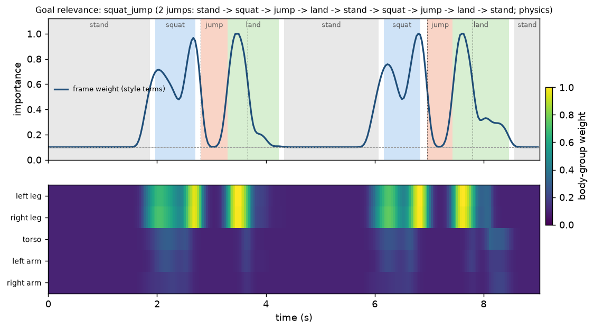

# Goal relevance: imitate what serves the goal, not everything in the clip

A clip holds movements that don't serve the action. A long-jumper waves to the crowd before the run-up. Someone shakes out their arms before a squat jump.

The task-first reward (`docs/SEMANTIC_REWARD.md`) already ignores them: its stage machine only checks stand → squat → jump → land. The style terms still imitate everything, though: the V-JEPA latent and the weak tracking terms.

`skill/importance.py` scores, for every reference frame and every body group, how much that moment matters for the clip's goal stages. `mjlab_tasks.TimeWeighted` then scales the style terms by that score, read from `A2H_IMPORTANCE`.

```bash
python -m skill.importance outputs/remote_latent/clips/squat_jump                  # physics only
python -m skill.importance outputs/remote_latent/clips/squat_jump --hype 0.2 1.4   # validation case
python -m skill.importance outputs/remote_latent/clips/squat_jump --vjepa auto     # + V-JEPA 2 predictor
```

Output: `outputs/goal_relevance/<clip>/importance.json` (+ `importance.png`, `task_spec.json`). Train with it:

```bash
python train_motion.py --task A2H-Task-Flat-Unitree-G1 --task-spec task_spec.json --importance importance.json ...
python experiments/latent_policy.py ... --policies task --importance importance.json
```

`importance.json` contains:

| Field | What it is | Who reads it |
|---|---|---|
| `fps`, `weight` | One value per reference frame, in [floor, 1]. | `TimeWeighted` |
| `body_weight` | `{left_leg, right_leg, torso, left_arm, right_arm: [per frame]}`; the qpos columns of each group are in `groups`. | Nothing yet (see Next steps) |
| `events` | Every goal event: its causal window, how much the goal quantity changed, each group's share. | Reports |

## Method

### 1. Goal events from the task spec

Each stage of `task_spec.json` gives one or more **goal events**. Each event has a *causal window*: the frames that can move its goal quantity. Every goal quantity below is a **sum over body groups**.

| Event | Frame | Causal window | Goal quantity |
|---|---|---|---|
| descent | squat bottom | from where the pelvis left standing height | CoM height (lower) |
| propulsion | takeoff | squat bottom → takeoff | CoM velocity along its takeoff direction |
| flight | apex | takeoff → apex | feet clearance below the ballistic CoM |
| absorb | lowest point after touchdown | touchdown → lowest point | vertical CoM velocity (braking) |
| balance | squat, settling after landing | the stage | CoM's horizontal offset from the feet |

### 2. Physics attribution (cheap, causal, always on)

**Split the CoM by cause, not by mass.** From the retarget we get MuJoCo body CoMs and masses. The CoM is the pelvis plus each group's mass-weighted offset from it.

- Each group owns its offset. An arm swung up raises the CoM relative to the body.
- The pelvis's own motion is credited to the **stance legs**, since in stance only they can move it. In flight it is credited to no one.
- Without this split, the heavy torso gets the credit for a jump the legs produce.

**Completeness.** An event's goal change splits *exactly* into per-frame, per-group increments, the completeness property of integrated gradients. A test checks that descent credit sums to the CoM drop.

**Back-and-forth motion cancels.** Each group's signed credit is summed over 0.27 s before taking its positive part. Waving up and down, or sideways, nets zero. A swing that is still rising at takeoff does not cancel.

**Normalisation.**
- Each event's credit is normalised to its weight. Propulsion and absorb count 1.0; descent and flight 0.6; balance 0.4.
- It is also scaled by **coherence**: net goal change ÷ positive credit.
  - A push or a braking has coherence ≈ 1.
  - A reference that just holds a balanced pose has coherence ≈ 0. Its sway is noise, not a goal.

**Frames outside every causal window get no credit,** whatever moves there. That includes the hype before the countermovement.

### 3. World model (V-JEPA 2 predictor, optional, GPU)

Code: `latent/predictor_relevance.py`.

**Setup.**
- HF `VJEPA2Model.forward(pixel_values_videos, context_mask, target_mask)` runs the encoder and then the predictor on the selected tokens.
- For each goal event, the retarget is rendered as a robot silhouette: 32 frames before the event plus 4 frames of the event, at the clip's viewpoint bucket.
- The event frames are **blanked** in the context video. The HF encoder attends over the whole clip, so without blanking the event would leak into the context tokens.
- The predictor predicts the event tokens from the context tokens.
- The error is L1 between the layer-normed prediction and the target, as in V-JEPA's training loss. It is taken over the patches the body covers.

**Occlusion.**
- For every 8-frame window of the context, the motion of the whole body, or of one body group, is removed. Its joints are interpolated straight across the window, so the pose stays continuous and only the movement is gone.
- The window is re-rendered with the baseline's crop. A new crop would itself look like motion.
- The relative increase in prediction error is that window's and group's relevance.
- This is occlusion attribution (Zeiler & Fergus) with a world model as the function. In other words, a counterfactual: "what if the arms hadn't moved then?"

**Why the robot render and not the human silhouette.**
- Body-part masks come exactly from MuJoCo's segmentation; the human silhouette has no part labels.
- It is also the domain the latent reward is computed in.

**Combining with physics.**
- Physics and V-JEPA scores are each scaled to [0, 1] and mixed. V-JEPA's share is `--vjepa-mix 0.35`; the predictor has a recency bias, which is why physics leads.
- The mix is smoothed (Gaussian, σ = 0.07 s) and lifted to a floor of 0.1, so style still regularises a little everywhere.
- A group's weight is the frame weight × its score relative to the most relevant group at that frame.

**Cost.** Per event, 25 clips of 36 frames through ViT-L. `squat_jump` and its hype variant come to about 400 forwards plus rendering: a few minutes on an A100, about an hour on a laptop CPU.

**Status.** The weights (`facebook/vjepa2-vitl-fpc64-256`, about 1.3 GB) are not cached on the laptop.
- The path is tested end to end with a tiny, randomly initialised `VJEPA2Model`.
- The `importance.json` shipped for `squat_jump` is **physics only**.
- The GPU job below computes the V-JEPA version.

## Result: squat_jump (physics)



**Frame weight.** Mean per stage; floor 0.1, peaks 1.0:

| Stage | stand | squat | jump (flight) | land | stand | squat | jump | land | stand |
|---|---|---|---|---|---|---|---|---|---|
| mean | 0.12 | 0.67 | 0.23 | 0.49 | 0.13 | 0.69 | 0.21 | 0.51 | 0.10 |

Recomputed on the proportional retarget (main, 2026-10-27).

- **Peaks.** The push before each takeoff (~2.6–2.7 s and 6.7–6.9 s) and the landing absorption (~3.4–3.6 s and 7.5–7.7 s) reach 0.9–1.0. A smaller peak (~0.65) is the countermovement descent.
- **Standing** stays at the floor.
- **Flight** is low. The reference doesn't tuck its feet (flight coherence 0), so nothing in it moves the goal. The jump itself is the stage reward's job.

**Body groups.**
- **Legs** carry the takeoff and landing. Legs together get about 0.9 of the propulsion and 0.98 of the absorb credit.
- **Arms** get about 6% of the propulsion. This retarget's arm swing is small; human arm swing adds roughly 10% of jump height (Lees et al. 2004).
- **Torso** gets about 5%. Its own swing relative to the pelvis is small; the pelvis's motion is credited to the legs.
- The left leg gets more than the right: the stance split follows foot height, and this retarget's left foot hovers. See `retarget_report.json`.

## Validation

`tests/test_goal_relevance.py`, all green.

**1. Synthetic squat jump (no MuJoCo).** A point-mass body: stand, countermovement, push, ballistic flight, absorbing landing.
- Injected arm-waving at 2 Hz, 0.2–1.4 s, gets weight ≤ floor + 0.02, and the arms' weight there is also at the floor.
- The push and the landing peak above 0.8, and the push window averages more than 0.5.
- The waving changes no weight outside its window. The task spec's stages are unchanged.

**2. Arm swing credited only when it helps.**
- With arms swinging up through takeoff, they get about 9% of the propulsion credit.
- With still arms, they get 0.
- With arms waving **sideways during the jump itself**, they get less than 1%; the legs get over 90%. The waving cancels and adds no vertical momentum.

**3. Real retarget (needs the G1 assets and the clip).** `squat_jump` with the hype injected into its qpos (`inject_hype`: both arms overhead, shoulder roll and elbow pumping at 2 Hz):
- The hype window gets the floor, for the frame and for both arms.
- Every propulsion and absorb window peaks above 0.8.
- Weights after the hype match the clean clip.
- The task spec's stages are unchanged.

**4. Predictor plumbing.** A tiny `VJEPA2Model` runs through the full mask, predict and score path. Only context frames get credit, and removing the motion keeps the window's end points.

## Counterfactual check in simulation (designed, not run)

`experiments/goal_relevance.py`, run as the `relevance` job of `scripts/remote_run.py`.

1. **Importance.** It builds the hype variant of the target and computes `importance.json` for the clean and hype motions: physics plus V-JEPA predictor.
2. **Latent target for the hype variant.** No human video of it exists, so the target is V-JEPA's embedding of its robot-silhouette render. It is centred on the robot-domain mean (`r_mean`), and the reused reward network is kept.
3. **Training.** It trains two `A2H-Task` policies on the hype variant in parallel, with identical settings: `plain` without `--importance`, and `weighted` with it. `--with-clean` adds a third policy on the clean clip as a reference.
4. **Evaluation:**
   - `task_success` and stages: `skill.task.evaluate`.
   - `hype_reproduction`: the projection of the policy's arm joints onto the hype direction over the hype window. 0 means arms as in the clean clip; 1 means it copies the waving. A local check on the references gives clean 0.0 and hype 1.0.
   - Arm and leg joint RMSE to the reference on the goal frames (weight > 0.5). This checks that weighting doesn't lose the movements that matter.

**Expected:** both policies keep `task_success`; `weighted` has a clearly lower `hype_reproduction` than `plain`, with similar leg RMSE on goal frames.

**GPU command** (main session; the VM pulls GitHub main, so merge and push this branch first):

```bash
python3 scripts/remote_run.py relevance --reuse outputs/remote_latent_v2 --target squat_jump --iters 1000
```

- **Output:** `outputs/remote_relevance/{counterfactual.json, squat_jump*/importance.{json,png}, policy_*/...}`.
- **Cost:**
  - Setup is about 10 min.
  - V-JEPA scoring and the hype bundle take about 5 min.
  - Two policies × 1000 iterations in parallel at about 2.4 s/iteration take about 40 min.
  - Rollouts and evaluation take about 5 min.
  - In total about **1 h ≈ 5.5 units**. With `--iters 600`, about 45 min ≈ 4 units.
- **Importance with V-JEPA only, no training** (about 15 min ≈ 1.3 units): add `--args "--vjepa-only"`.

## Literature

**Attribution**
- Occlusion attribution: Zeiler & Fergus, 1311.2901.
- Integrated gradients and the completeness axiom: Sundararajan et al., 1703.01365. Our per-frame momentum increments are an exact, path-based decomposition of the same kind.

**Temporal credit assignment**
- RUDDER, 1806.07857: redistribute a return to the steps that caused it. Here the "return" is each goal event's physical quantity, so the decomposition is exact.
- Keyframing the Future, 1904.05869: discovering the few frames that matter for prediction.

**World-model counterfactuals**
- V-JEPA 2, 2506.09985; V-JEPA, 2404.08471: latent prediction from masked context.
- Counterfactual World Modeling, 2306.01828: masked prediction as a probe of what a scene's dynamics depend on.

**Why not imitate everything**
- Causal confusion in imitation learning, 1905.11979: copying nuisance correlates hurts.
- DeepMimic, 1804.02717: per-joint imitation weights.
- AMP, 2104.02180: task plus style.

**Biomechanics**
- Centroidal dynamics: Orin, Goswami & Lee, Autonomous Robots 2013.
- Arm swing in the vertical jump: Lees, Vanrenterghem & De Clercq, J. Biomech. 2004.

## Next steps

- **Per-body weighting.** `body_weight` isn't used in training yet. `TimeWeighted` scales the whole latent and tracking term per frame. Weighting the tracking terms per body (mjlab's per-body errors) needs a change in `mjlab_tasks.py`, which other sessions are editing now.
- **The human video side.** Locate body parts in the athlete's silhouette from the pose keypoints (`human.npy`), so V-JEPA scores the video itself, not only the retarget.
- **A real hype clip.** Score one directly; the current test uses synthetic waving.
