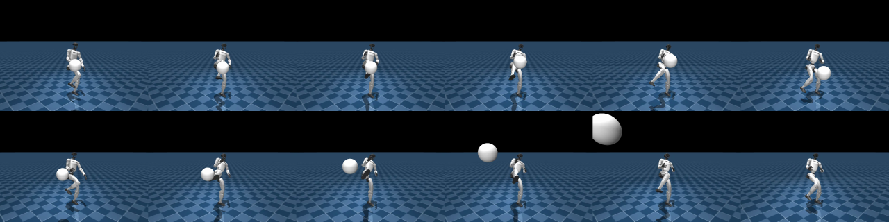

# Kick a ball: the first object in the G1's scene (side bet, 2026-10-29)

Stage 1 of `docs/OBJECTS_PLAN.md`: the `front_kick` clip's policy, now with a soccer ball to kick. This is a
side branch (`claude/objects-kick`), not merged: nothing in the main pipeline changes. Two new files plus a job
script:
- `mjlab_objects.py`: registers `A2H-KickBall-Flat-Unitree-G1`.
- `experiments/kick_ball_eval.py`: the evaluation.
- `scripts/kick_ball_job.sh`: the Colab job.

## The task

`A2H-KickBall-Flat-Unitree-G1` is mjlab's tracking task (the one `kp_front_kick_tracking` was trained on) plus:

| | |
|---|---|
| Ball | Size-5 soccer ball: sphere r = 0.11 m, 0.43 kg, friction 0.6, free joint. An MJCF primitive, no asset needed. |
| Where | The clip's front kick is a **high** kick: the toe rises past 0.8 m at ~5 m/s. A ball on the floor is never in its path. So the ball is held still at the point where the reference toe moves fastest on the way up (`kick_strikes`), like a target a coach holds out. It is let go when something moves it, or 0.15 s after the reference strike (a miss). The clip has two kicks, and each gets a fresh ball. |
| Frame | Placed relative to the robot, as mjlab's tracking rewards place the reference bodies (`body_pos_relative_w`). Training moves it up to ±3 cm on each axis. |
| Observation | 7 numbers appended to the tracking input: the ball's position and velocity in the torso's yaw frame, and whether a ball waits to be kicked. A tracking checkpoint warm-starts the policy, and the new inputs start at zero weight, so it first acts exactly like the tracker. |
| Reward | The tracking terms, unchanged, plus three ball terms (below). |

The three ball terms:
- `ball_reach`: toe-to-ball distance (σ 0.1 m), from 0.1 s before the strike until the ball goes.
- `ball_hit`: a bonus when the kicking leg makes the hit.
- `ball_speed`: for 1 s after a hit, the ball's horizontal speed along the reference toe's direction at the
  strike, up to 6 m/s.

A hit is a held ball that moved faster than 0.6 m/s. It counts for the kicking leg if the right toe, ankle or knee is within 0.1 m of the ball's
surface.

## Results

256 rollouts of the whole clip per row, from its start, two kicks each (512 balls). "Jitter" moves each ball up
to 5 cm on each axis from the strike point. Ball speed is the best horizontal speed along the strike direction in the
second after a leg hit.

| Policy | Ball | Leg hits | Ball speed | Ball travel in 1 s | Falls | Joint error |
|---|---|---|---|---|---|---|
| `kp_front_kick_tracking` (zero-shot: ball inputs at zero weight) | clean | 48% | 0.4 m/s | 0.7 m | 0% | 0.106 rad |
| | jitter 5 cm | 40% | 0.4 m/s | 0.7 m | 0% | 0.106 rad |
| **A2H-KickBall, 800 iterations from the tracker** | clean | **100%** | **5.9 m/s** | **7.1 m** | 0% | 0.124 rad |
| | jitter 5 cm | **100%** | **5.6 m/s** | **6.7 m** | 0% | 0.123 rad |



Video: `docs/results/kick_ball_side_by_side.mp4`.

**What changed:**
- The tracker alone kicks late and low. It brushes the ball half the time and drops it at the robot's feet.
- After training, the robot meets the ball with the foot on every kick and sends it up and away.
- The cost is a little extra joint error, 0.106 → 0.124 rad: the kick bends toward the ball. Still no falls, with
  mjlab's random pushes on during training.

**Compute:**
- Training: 800 iterations × 4096 envs, 1.45 s per iteration on a Colab A100, about 19 minutes.
- The whole job (setup, the three evaluations, training) took 26 minutes and ~2.5 compute units.

**Two bugs, fixed before the reported run:**
- *A stale read.* The event first moved the ball, then read its velocity in the same step. mjlab's derived state lags
  a write until the next `forward()`. So a second ball spawned while the first still flew read as "already hit", and
  never appeared. The ball is now read before anything moves it.
- *The leg test.* "Kicking leg = the robot body nearest the ball" often picked the torso or a wrist for a ball at
  chest height. Clean foot strikes then scored as other hits and earned no speed reward. It now asks whether the toe,
  ankle or knee is within 0.1 m of the ball's surface.

A first run trained with both bugs still reached a 95% leg-hit rate at 4.5 m/s, re-scored with the fixed code.

**Limits:**
- The ball hangs in the air until it's kicked: there is no tee and no thrower.
- One clip, one ball size, and no ball physics randomisation (mass, friction).
- Nothing about the ball comes from the video. Where to put it is computed from the robot's own reference kick, so
  stage 0 of the plan (seeing the ball in the video) is still open.
- Sim only.

## Reproduce

```bash
# On a Colab GPU VM, with the repo on this branch and the tracker's model_1499.pt + motion.npz in $IN:
IN=/content/a2h/inputs OUT=/content/a2h/outputs/kick_ball ITERS=800 bash scripts/kick_ball_job.sh
```

Locally (mjlab 1.6 runs on CPU, `CUDA_VISIBLE_DEVICES=` for training):

```bash
$MJLAB_PY experiments/kick_ball_eval.py --checkpoint weights/kickball_front_kick/model_799.pt --motion weights/kp_front_kick_tracking/motion.npz --out out -n 8
```
