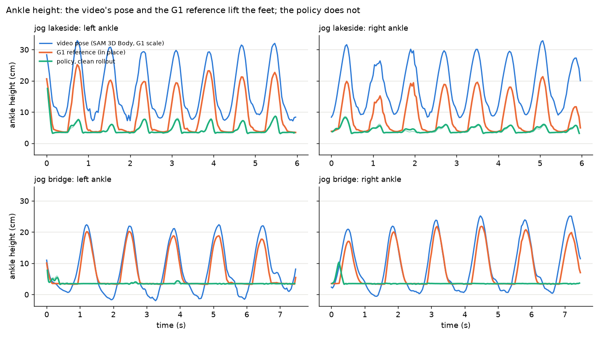
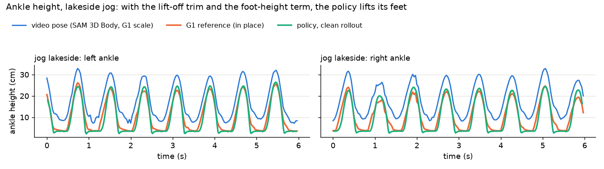
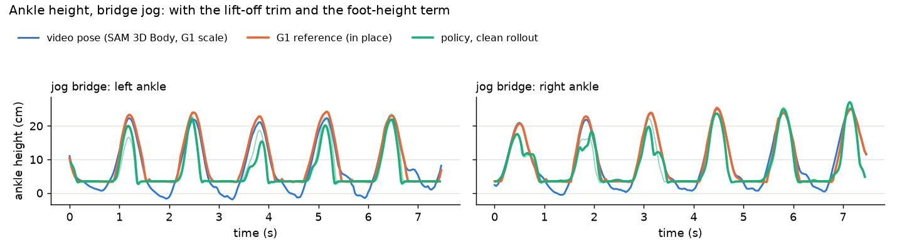
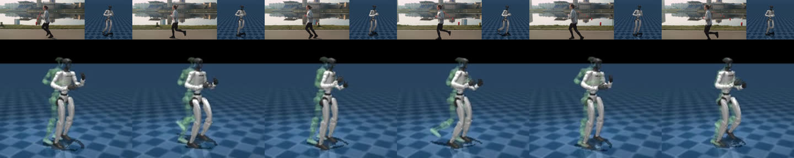

# Real athletes: free-licence video through the pipeline; the lakeside jog's tracker passes its spec after the lift-off trim, a foot-height term and a continuous run (2026-10-31)

**Question:** the stack was built on our own phone clips. Does it also work on video of other people, filmed by
someone else, that the submission may legally show? And can a move that travels (a run) be trained for when the G1 has
to do it on the spot?

**Short answer:**
- The front end, retarget, spec and variants work on all four clips.
- A run-in-place mode keeps the planted feet still (0.2–0.5 cm/s of slip: 0.4 and 0.2 on the jogs, 0.5 on the hurdles
  film) at the cost of knee fidelity.
- The first trackers (1,250 iterations) completed none of their clips: the jogs shuffled their feet. The video's pose
  and the reference lift each foot 15–25 cm; the loss was in training, plus 9–40% of each swing that the in-place
  contacts held on the floor ("Where the foot lift goes").
- With the contacts trimmed, a foot-height tracking term, and one continuous 1,000-iteration run (not ablated: which
  of the three made the difference isn't known):
  - **the lakeside jog passes its spec**: 100% clean, 98% under 1 m/s pushes, 7/7 held-out variants, no falls. Its
    spec requires 3 of its 13 key moments; the other 10 are optional details that may be skipped (the reference
    itself skips 6 of them);
  - the bridge jog now lifts its feet too, but passes none of its runs: it does 53% of its 15 key moments, and fails
    a required one on where a foot lands, fore and aft.
- The kick doesn't fit the G1 as filmed; the boxer wasn't retrained.
- The lakeside run is wired into the demo (`remote_latent_ra_jog`, credited); not deployed.

Every number below is in `docs/results/real_athletes/`:

| File | What it holds |
|---|---|
| `audit.json` | the pipeline audit |
| `in_place_*.json` | the in-place measurements |
| `policies.json` | the first trackers' training and evaluations (ra5 and before) |
| `policy_ra6.json`, `policy_ra7.json` | the retrained lakeside and bridge jogs: training and evaluation (`real_athletes.py summarize`) |
| `foot_lift_ra5/6/7.json` | ankle heights and swings: pose, reference, travelling retarget, policy (`real_athletes.py feet`) |
| `facts.json` | the rest: coverage, the intake's warnings, the kick, foot heights, job times. Written by `experiments/real_athletes.py facts` from the run logs and rollouts. |

## The clips

Licences were read on each clip's page on 2026-10-30. The record, with authors, page and file URLs, trims and the
credit lines, is `docs/real_athletes/clips.json`. The video files stay out of git.
- Pexels and Mixkit licences need no attribution. The site credits each clip anyway (`web.json` "credit", shown on the
  run and build pages and the showcase tab).
- These are stock-footage people (two runners, a kicker, a boxer), not famous professionals. Clean, openly licensed
  footage of famous athletes doing one move is close to nonexistent; broadcast footage is copyrighted.

Each clip was checked by eye on contact sheets for one person, full body, and no cuts:

| Clip | Source | Licence | Trim | Verdict |
|---|---|---|---|---|
| `jog_lakeside` | [Pavel Danilyuk, Pexels 4065467](https://www.pexels.com/video/a-man-wearing-sunglasses-running-in-the-street-4065467/) | Pexels License | 0–6.0 s | kept: side-on dolly shot of a jogger; a second runner enters at about 7 s |
| `jog_bridge` | [RDNE Stock project, Pexels 8402092](https://www.pexels.com/video/a-beautiful-woman-jogging-on-a-sunny-day-8402092/) | Pexels License | 0–7.5 s | kept: side-on jogger, slowly panning camera; a cut at about 8 s |
| `taekwondo_kick` | [rubenvelasco, Mixkit 49634](https://mixkit.co/free-stock-video/a-young-man-performs-a-karate-kick-to-the-air-49634/) | Mixkit Stock Video Free License | whole 6.4 s | kept: static camera, black background, a side kick |
| `shadow_boxing` | [Ron Lach, Pexels 8745108](https://www.pexels.com/video/woman-doing-shadow-boxing-8745108/) | Pexels License | 0–5.5 s | kept: backlit, the head briefly hidden by a foreground object |
| Pexels 7187054 / 7187058 (sprinters) | RDNE Stock project | Pexels License | | rejected: cuts every second or so; one runs toward the camera |
| Neymar's free kick (Commons) | Rodrigogomesonetwo | **CC BY-SA 4.0** (the file page's `{{self|cc-by-sa-4.0}}`), not CC BY | | excluded by licence, not downloaded |

**Gaps:**
- **Jogs, not a sprint.** The two side-on sprinter clips on the free sites have cuts every second or so.
- **No hurdle or high-jump approach.** The only ones under an allowed licence were vertical phone footage looking down
  the lane.

## Pipeline quality (the pipeline audit's numbers)

Processing ran on Modal (job `pro_ra`, an L40S, 12 minutes for all four): SAM 3.1, then SAM 3D Body, the camera
intake, and the retarget. The two jogs then had their retargets redone locally with the final in-place steps
(`experiments/real_athletes.py reretarget`), last with the lift-off trim ("Where the foot lift goes"). The jog rows
below are that retarget. Before the trim they were: knee / hip error 19.9 / 12.9° (lakeside) and 11.0 / 13.3° (bridge),
11 and 10 key moments, and the bridge at its ankle-pitch limit in 16% of frames, keeping 35/36 variants. With the trim the
bridge's ankle is at its pitch limit in 44% of frames, against 16% before; where in the stride isn't measured.

Columns: coverage comes from `facts.json` "processing"; the rest from `audit.json`
(`experiments/real_athletes.py audit`).
- **IK error:** the mean distance between the G1's frames and their targets.
- **Angle error:** the mean flexion error to the human.
- **Limits:** the share of frames with any joint within 1° of a limit.
- **Variants kept:** of the 36 training variants, after the physical filter (`skill/variations.py`).

| Clip | SAM 3.1 visible | SAM 3D Body pose | IK error, knees / feet / hands (cm) | Angle error, knee / hip (°) | Fastest joint (rad/s) | Limits | Spec: key moments, self-check | Variants kept |
|---|---|---|---|---|---|---|---|---|
| `jog_lakeside` (in place) | 100% | 100% | 3.9–4.9 / 0.2–0.3 / 0.1 | 16.1 / 11.2 | 11.7 | 0% | 13, 14/14 | 36/36 |
| `jog_bridge` (in place) | 100% | 100% | 3.9–4.5 / 0.1 / 0.1 | 12.6 / 10.4 | 10.4 | 44% (ankle pitch: 25% / 19% left / right) | 15, 16/16 | 36/36 |
| `shadow_boxing` | 99% | 100% | 1.0–1.5 / 0.0–0.1 / 0.1 | 3.8 / 3.6 | 13.4 | 5% | 3, 5/5 | 36/36 |
| `taekwondo_kick` | 100% | 100% | 2.0–5.4 / 0.3–1.2 / 0.1 | 12.0 / 9.0 | 20.0 (at the cap) | **67%** | 4, 6/6 | 24/36 |

The intake's warnings (`facts.json`):
- The bridge jogger is 383 px tall, under the 400 px it wants.
- On the kick, few frames register against the black background, so the camera was left uncompensated. That's right
  for this static camera.

The in-place jogs' knee and hip errors are the cost of running on the spot (see "Run in place" below), not pose error.
Travelling, the same clips retarget at 1.1° and 1.6° of knee error.

**The kick does not fit the G1 as filmed.**
- The reference pins the right hip yaw at its limit in 45% of frames, the hip pitch in 33% and the knee in 25%
  (`audit.json`). A side kick at hip height asks for more hip range than the G1 has.
- Its torso tilts to 1.386 rad (79°). The robustness eval's fall rule is 1.4 rad, which the reference trips itself, so
  the eval refuses to score it (`facts.json` "kick").
- Training agreed. After 1,000 iterations on Modal its episodes lasted 87 of 317 steps (50 Hz). They ended mostly on
  mjlab's end-effector height check: 47.8 `ee_body_pos` terminations per logging window, against 8.5 `anchor_pos`.
- A lower kick, or a front kick (as on our own clip), is what this robot can be trained for.

## Where the foot lift goes

The first trackers (job `athletes_ra5`) shuffle: they keep the feet down while their reference lifts them. Is the lift
already missing in the pose, lost in the in-place retarget, or lost in training? `experiments/real_athletes.py feet`
plots each ankle's height per frame for three traces: SAM 3D Body's pose on the G1's skeleton (before any contact is
used), the in-place G1 reference the policy trained on (its qpos through forward kinematics), and the policy's two
saved clean rollouts. Its numbers are in `foot_lift_ra5.json`.



A swing is a run of frames with the ankle more than 3 cm above that trace's own floor (its 5th percentile). Duration
and peak are medians over the clip, left / right:

| | Lakeside: swing (s) | Lakeside: peak (cm) | Bridge: swing (s) | Bridge: peak (cm) |
|---|---|---|---|---|
| Video pose (SAM 3D Body) | 0.57 / 0.53 | 22.6 / 20.8 | 0.90 / 0.87 | 23.1 / 23.2 |
| Travelling retarget (no `--in-place`) | 0.50 / 0.57 | 21.6 / 22.1 | 0.83 / 0.58 | 24.5 / 20.8 |
| In-place reference the ra5 policy trained on | 0.37 / 0.38 | 17.4 / 15.4 | 0.50 / 0.53 | 15.5 / 17.1 |
| In-place reference with the lift-off trim (below) | 0.43 / 0.43 | 19.7 / 18.2 | 0.60 / 0.63 | 19.9 / 20.7 |
| ra5 policy, clean | 0.12 / 0.16 (7 and 1 swings) | 4.4 / 4.8 | none / 0.18 (0 and 1 swings) | – / 6.8 |

- **Most of the loss is in training.** The reference lifts each ankle to 15–25 cm every stride. The policy's ankles sit
  at a median of 3.5–3.7 cm, and their swings, where there are any, peak 4.4–6.8 cm above the floor. The highest single
  points are 17.6 cm (lakeside, left, at the clip's start) and 10.6 cm (bridge, right).
- **The in-place retarget also cut each swing short**, by 9–40%: 0.37–0.53 s and 15–17 cm, against 0.50–0.83 s and
  21–25 cm travelling. The cause was contact detection. Once the travel is restored (step 2 of "Run in place"), a
  planted foot stands still. `stance_mask`'s test (within 10 cm of the floor and slow) then also took in the first and
  last ~0.1 s of each swing, and `plant_feet` held those frames on the floor. Stance went to 39–51% per foot, against
  28–33% of frames with the pose's ankle within 3 cm of its floor.
- **The fix** (`retarget.trim_lift_off`, in place only): a contact starts once the pose's ankle is within 3 cm of the
  contact's low level (its lower quartile) and ends when it rises past it, trimming at most 4 frames (0.13 s) from
  each end, so a long standing contact whose ankle drifts up stays planted. The swings come back to 0.43–0.63 s and
  18–21 cm, stance to 30–37%. Slip stays at 0.4 and 0.2 cm/s (`in_place_jogs.json`). Both specs still compile and their
  references complete them: 13 key moments on the lakeside, 15 on the bridge.
- **What the pose itself shows:** clean, regular lifts on both clips. On the lakeside clip the pose's lower ankle rarely
  reaches its floor (troughs at 8–10 cm), so its absolute heights read high. The swing peaks are measured above each
  trace's own floor.

## Retrained after the lift-off trim, with a foot-height term and a continuous run: the lakeside jog passes (job `athletes_ra6`)

**Result: the lakeside jog's tracker completes its spec in all 64 clean rollouts.** It also does so in 98% of rollouts
under 1 m/s pushes, and in all 64 rollouts of each of its 7 held-out variants. None of the 576 rollouts fell
(`policy_ra6.json`).

Three things changed from the first trackers (ra5, below):
1. **The reference:** the in-place retarget with the lift-off trim ("Where the foot lift goes"). Its swings are longer
   and higher, and its spec has 13 key moments instead of 11.
2. **The reward:** a foot-height term on the tracking task (`mjlab_tasks.FeetHeight`). On the frames where the
   reference's foot is more than 3 cm off its floor, it pays exp(−err² / 0.1²) per foot for the ankle's height error
   against the reference's. It is set by `docs/real_athletes/reward_feet_height.json` (weight 2, std 0.1 m), through
   `variant_policy.py --reward-config`. The default (weight 0) leaves the task as mjlab's.
   - Why it was needed: mjlab's tracking terms see the feet only inside `motion_body_pos`, an average over 14 bodies
     at std 0.3 m. A swing foot left 15 cm low costs that term about 1/50.
3. **The training:** one continuous run of 1,000 iterations at 4,096 envs, from the squat-jump warm start. The first
   trackers had three restarts (below).

These were not ablated, so the result can't be credited to any one of them. What the figure does show: the policy's
feet now follow the reference's.



| Lakeside jog | Swings (left / right) | Swing (s) | Peak above floor (cm) | Highest (cm) | Median (cm) |
|---|---|---|---|---|---|
| Reference (trimmed, in place) | 8 / 8 | 0.43 / 0.43 | 19.7 / 18.2 | 26.2 / 24.7 | 7.6 / 8.9 |
| ra6 policy, clean | 8 / 8 | 0.36 / 0.38 | 21.6 / 19.9 | 26.6 / 24.4 | 4.2 / 5.7 |
| ra5 policy, clean (for comparison) | 7 / 1 | 0.12 / 0.16 | 4.4 / 4.8 | 17.6 / 8.6 | 3.5 / 3.7 |

**Evaluation** (`experiments/robustness_eval.py` on the Colab GPU, 64 rollouts per condition, no V-JEPA):

| | Success | Falls | Torso error (m) | Joint error (rad) |
|---|---|---|---|---|
| Clean | 100% | 0% | 0.086 | 0.124 |
| 1 m/s pushes | 98% | 0% | 0.302 | 0.130 |
| Held-out, each of the 7 (half and double speed, 0.7x and 1.25x amplitude, a time warp, two mirrored) | 100% | 0% | 0.086–0.291 | 0.118–0.143 |

- A run passes when it completes every required key moment in order without falling (`skill/keypose.py`).
  - The lakeside spec marks 10 of its 13 key moments optional, details of how this person ran, and those may be
    skipped. 3 are required. The reference itself skips 6 and passes. The showcase tab says "3 of 13 key moments
    required" next to its 100%.
  - So the eval's "stages" share, which counts only completed ones, reads 65% on a passing run.
- The torso error is higher than ra5's 0.053 m. Our reading, not tested: a policy that swings its legs moves its
  trunk more than one that shuffled under a still trunk.
- **Training:** one Colab T4, 3.1 s per iteration, 53.7 minutes. Episodes ran their full length (497 of 500 steps).
  The foot-height term's episode reward rose from 0.01 to 1.00. The job ran 61 minutes in all with the eval and the
  recorded pushes.
  - Colab refused the A100 and the L4 ("no quota or entitlement"), so it ran on the T4.
- **In the demo:** `outputs/remote_latent_ra_jog`, assembled by `experiments/real_athletes.py assemble` with its Pexels
  credit. It also has its build-view variants (`build_variants_view.py`: 36/36, 4 ghosts), a showcase tab
  (`web/public/showcase/jog-lakeside`, 3.0 MB) and `OWN` in `web/src/buildview/data.ts`.
  - Its `side_by_side.mp4` was rebuilt for the trimmed reference: the video half from the processed clip's, the robot
    half re-rendered.
  - Not deployed.

### The bridge jog with the same recipe (job `athletes_ra7`): it lifts its feet, but doesn't pass

The lakeside passed, so the bridge got the same recipe. Its variants were built locally (36/36, 5/7 held out), and it
trained on one Colab T4: 1,000 iterations in 56.7 minutes, 66 minutes with the eval (`policy_ra7.json`).



- **The feet lift now.** Each foot makes all 6 of its reference's swings. They peak at 16.8 / 18.3 cm against the
  reference's 19.9 / 20.7 cm, against 0 and 1 swings for ra5 (`foot_lift_ra7.json`).
- **It still doesn't pass.**
  - Clean: 0% success, 53% of key moments done, no falls, joint error 0.112 rad. The spec is stricter than the
    lakeside's: 3 of its 15 key moments are required, and its reference skips only 1. (ra5's 18% was on a different
    spec, the pre-trim reference's 10 key moments, so the two shares don't compare directly.)
  - 1 m/s pushes: 0%, no falls.
  - Held out: 0–2% on each of the 5 variants.
- **Where it stops:** at stage 11 of 16, "right foot down, left foot up" (4.4–5.0 s), in 73% of clean rollouts, and at
  stage 10 in the rest. The check that fails is the foot's fore-aft position (`left ankle x`), not its height. The
  in-place reference keeps each planted foot under a still hip; the policy puts it elsewhere.
- **Not tried:** more iterations, a foot-position term, or the Muse reward agent. The agent trains its rounds on Modal,
  which has no budget, and tunes the task-first tasks' settings, not the tracking task's. It is not in the demo.

## The first trackers (job `athletes_ra5`): they stay up but complete none of the clips

**Result: none of the three trackers passes its spec.**
- After training, each stays up: no falls on the clean clip, 0–2% under 1 m/s pushes.
- Each tracks its reference's torso within 3.5–7.2 cm.
- But at full speed none completes the spec's key moments in order. The jogs shuffle their feet instead of lifting them.
- The lakeside jog completes its two slowest held-out variants (half speed, and mirrored at 1.6x longer) in all 64
  rollouts of each.
- No run was added to the hosted demo.
- The demo wiring was run end to end on these runs and set aside (`outputs/_real_athletes_not_passing/`, outside the
  patterns `build_space.py` ships): `assemble --all`, `build_variants_view.py`, the API with its credit, and a showcase
  bundle.



**Recipe.** As for the squat jump:
- `tracking_var` trained on the clip's variants (`experiments/variant_policy.py`), one policy per clip.
- Warm-started from the squat-jump variants tracker (`remote_variants_s3_sj/policy_tracking_var/model_1499.pt`).
- Then the held-out variants and recorded pushes (`scripts/real_athletes.sh`, `remote_run.py athletes`).

**Training: 1,250 iterations in three pieces**, because the GPU budget ran out on the way. Each piece is a separate
warm start from the previous checkpoint (`--init`): the weights carry over, but the optimizer and the iteration counter
restart.
1. **Modal (L40S, 4,096 envs): 250 iterations kept.**
   - All four clips trained in parallel in one container. The workspace hit its billing-cycle spend limit and the
     container was stopped. Its training logs end at iterations 448 (lakeside), 489 (bridge) and 455 (boxing).
   - Checkpoints are every 250 iterations, so iteration 250 was kept. Further calls were refused.
   - The kick got further, to iteration 999. It had fewer variants to build (24, not 35–36), so it started training
     about 7 minutes earlier, and it ran faster: 1,000 iterations in 23.5 minutes against about 2.3 s per iteration for
     the others (`facts.json` "modal_training_before_the_limit"). Its rollout after training was cut off.
   - Before training, building the variants took about 30 minutes in the job: about 40 motion files per clip, four
     clips sharing 8 CPUs while the GPU idled. Build them beforehand next time (`variant_policy.py --build-only`, or
     the new `--reuse-build` and `real_athletes.sh --from`).
2. **This Mac's CPU (512 envs): 250 iterations, from the GPU iteration-250 checkpoint.**
   - mjlab runs on Warp's CPU backend with `CUDA_VISIBLE_DEVICES=` empty, at about 10 s per iteration.
   - Each iteration has an eighth of a GPU iteration's samples (512 envs, not 4,096).
   - The processes ended at iterations 551–591; the iteration-500 checkpoint was kept.
3. **Colab (one L4, 4,096 envs, job `athletes_ra5`): 750 iterations, from the CPU iteration-500 checkpoint.** The three
   clips ran in parallel, then the eval and the recorded pushes. The session stopped itself when the job ended.

So the final policies have 250 + 750 = 1,000 iterations at 4,096 envs and 250 at 512 envs in between: more than the
planned 1,000, but not a continuous run.

**Evaluation** (`experiments/robustness_eval.py`, no V-JEPA):
- "Stages" is the share of the spec's key moments done in order; success needs all of them.
- Held-out variants are tempos and amplitudes outside the training grid (`skill/variations.py` HELD_OUT). Only those
  that pass the physical filter are scored.
- Numbers are in `policies.json` "eval_final"; the final eval ran on the Colab GPU with 64 rollouts per condition.

| Clip | Clean: success / stages / falls | Torso error (m) | Joint error (rad) | 1 m/s pushes: success / falls | Held-out variants: success / falls |
|---|---|---|---|---|---|
| `jog_lakeside` (in place) | 0% / 17% / 0% | 0.053 | 0.145 | 0% / 2% | 29% / 0% over 7 variants (the half-speed and mirrored 1.6x ones: 100% each, the other 5: 0%) |
| `jog_bridge` (in place) | 0% / 18% / 0% | 0.035 | 0.116 | 0% / 0% | 0% / 0% over 5 variants (its filter dropped the mirrored 1.6x and the half-speed ones, so the two the lakeside policy passes weren't scored) |
| `shadow_boxing` | 0% / 21% / 0% | 0.072 | 0.146 | 2% / 0% | 4% / 0% over 7 variants |
| `taekwondo_kick` | not scorable: the reference itself trips the fall rule (above) | | | | |

**Joint error by training stage** (lakeside / bridge / boxing; `policies.json`). The first two rows were scored on CPU
with 32 rollouts per condition, the last on the Colab GPU with 64:

| After | Joint error (rad) |
|---|---|
| 250 GPU iterations | 0.258 / 0.208 / 0.210 |
| + 250 on CPU (512 envs) | 0.167 / 0.193 / 0.172 |
| + 750 on Colab | 0.145 / 0.116 / 0.146 |

For comparison, the squat-jump tracker that is the warm start scores 0.093 rad, with 100% clean and 82% held-out
success (`facts.json` "warm_start_squat_jump", from `outputs/remote_robust_s3_sj`).

**Where the jogs fail** (`facts.json` "jog_feet": the reference's ankles against the final policy's two saved clean
rollouts).
- The reference's ankles are above 18.0–19.9 cm (lakeside, right / left) and 17.6–18.7 cm (bridge) for 10% of the
  clip, with peaks of 20–25 cm.
- The policy's ankles sit at a median of 3.5–3.7 cm. They're above 5.6–7.0 cm for 10% of the clip on the lakeside, and
  3.5–3.6 cm on the bridge. It shuffles in place while tracking the trunk.
- So neither completes its second key moment:
  - lakeside: "left foot up, right foot forward", with a 5.9 cm left-foot-height tolerance;
  - bridge: "left foot up, right hand forward", with 4.3 cm.
  - Both ask for the left foot off the floor for 0.1 s.
- Slowed to half speed, the lakeside policy does every key moment.
- **Our reading, not tested:**
  - A run in place is a hard version of a jog. Its flights go straight up, with no forward momentum to carry the body,
    so a tracker may earn more by keeping its feet down than by risking the hop.
  - Under the tracking reward, which weights body positions, the feet are a small share of the error.
  - The fixes we'd try: more iterations in one continuous run; a foot-clearance term or the stage-weighted task reward
    (`taskhybrid_var`); or the half-speed variant as the clip.

**Where the boxing fails.** Its spec is footwork: a turn and steps back and to the side. On the clean clip the policy
tracks the body to 8–13 cm RMS (pelvis 8.1, hands 10.0–12.0, feet 10.0–13.1 cm; `facts.json`) without falling, but
doesn't complete those steps.

**Compute** (`facts.json` "job_times"):
- Modal: the processing job (22:37–22:50), and one training job from 23:00 until the spend limit stopped it.
- Colab: one L4 from 02:52 to 04:26.
- The retrain (2026-10-31, PDT): Colab refused the A100 and the L4 for lack of quota, so it ran on a T4, one session
  at a time. Lakeside (`athletes_ra6`): 11:34–12:37. Bridge (`athletes_ra7`): 12:37–13:44. Each session stopped itself
  when its job ended.
- No other GPU; nothing on Modal.

**What the deploy needs, once a clip passes** (steps 1–4 are done for the lakeside jog, `remote_latent_ra_jog`; step 5 is
the deploy):
1. `python3 experiments/real_athletes.py assemble outputs/remote_athletes_<tag>`. Only clips whose policy completes
   the clip become `outputs/remote_latent_ra_*` runs, with a `web.json` credit.
2. `python3 scripts/build_variants_view.py outputs/remote_latent_ra_*`
3. `python3 experiments/real_athletes.py showcase <clip>...`: the 3D bundle and a credited showcase tab. It refuses a
   run that doesn't pass.
4. Map the clip to its bundle in `web/src/buildview/data.ts` (`OWN`).
5. `scripts/build_space.py` ships `remote_latent_ra_*` runs whose `eval.json` says they pass, with their `robust.json`.
   Then the usual Space and Pages redeploy (`docs/DEPLOY.md`); the credit components are new in the web build.

## Run in place (`pipeline.py --in-place world`)

A run's reference travels several metres. The tracking tasks learn travel poorly (docs/FRONTIER_TRAVEL.md), and a
demo floor is finite. So `--in-place METHOD` turns the travelling motion into the same gait on the spot, keeping the vertical
root motion (the bounce, the flights) and the foot contacts.

It is an option of the retarget (`retarget.proportional_motion(in_place=...)`). It is passed through `pipeline.py`,
`experiments/process_clips.py`, `scripts/pro_clips.sh` (`IN_PLACE=`) and `scripts/remote_run.py --in-place`.
`experiments/real_athletes.py reretarget` redoes a stored clip's retarget without a GPU. The clip's `meta.json`
records it, for example the bridge jog:

```json
"in_place": {"method": "world", "travel_removed_m": 5.776, "mean_speed_m_s": 0.77, "stride_s": 1.35,
             "root_travel_left_m": 0.0, "floor_drift_removed_m": 0.303,
             "travel_restore": {"before_m": 6.596, "after_m": 5.776, "added_xy_m": [0.663, -3.674]}}
```

### Steps, in order

1. **Level the floor** (`level_floor`). A camera pitch error turns travel into height. On the bridge jog the floor
   rose 0.30 m over 7.5 s, so its second half had no foot near the floor: no contacts, and every variant was dropped,
   the clip itself included.
   - The fix: a line through the lowest foot's lowest point per 0.5 s, refitted without the windows more than 5 cm
     above it (flights), and applied only when at least 75% of the windows lie on it.
   - The hurdles film, which ends in a long flight, is left alone (`in_place_hurdles.json`: no drift removed).
2. **Make the root follow the planted feet** (`restore_travel`). While the lowest foot is on the floor, the root must
   move at minus that foot's velocity relative to it. Where the root's path differs, the difference, smoothed over
   1 s, is added if it averages over 0.3 m/s. It is a vector, so it can add missing travel or remove drift:
   - **Lakeside jog (a dolly shot):** its background is far away and barely moves, so the camera compensation
     recovers 0.23 m of travel. The pose reads as a treadmill run: in the travelling retarget the lowest sole moves at
     1.8 m/s while down, and the contact detector, which needs a planted foot to stand still, finds no contacts. The
     restore brings the travel to 5.90 m and the contacts back (stance 33% / 30% per foot, after step 3's trim).
   - **Bridge jog (a panning camera):** the root already travels 6.60 m, but partly sideways of where the feet go. The
     change, (+0.66, −3.67) m, mostly removes that drift, leaving 5.78 m. With the floor levelled, stance goes from
     24% / 21% to 37% / 34% (after step 3's trim).
   - **Hurdles:** 3.21 → 2.24 m.
   - Only with `--in-place`: the default retarget is unchanged.
3. **Find the contacts** on that travelling motion, where a planted foot stands still, then trim each one where the
   pose's ankle is more than 3 cm above the contact's lower quartile, at most 4 frames from each end (`trim_lift_off`, `IN_PLACE_LIFT_M`). Without the
   trim, the still-standing feet passed the detector's 10 cm test into the start and end of each swing, and the swings
   came out 9–40% short ("Where the foot lift goes").
4. **Remove the travel**, by one of three methods:

| Method | What it does | What it costs |
|---|---|---|
| `world` (default) | The root is held where it starts. Each contact is pinned under it at the contact's mean position (`plant_feet(hold_root=True)`), and the pin is bridged across the swing. | The stance leg can't sweep back under a still hip, so it bends instead: knee angles differ from the human's. |
| `soft` | As `world`, but the root keeps its surge and sway within a stride. Each horizontal axis is squashed (tanh) into ±10 cm of a fixed centre (`IN_PLACE_SOFT_M`): a 20 cm band, so up to about 0.2 m from the start frame. | Measured below: it doesn't help. |
| `stride` | The planted motion minus its per-stride travel (a moving average of the root over one stride, `stride_drift`). | Every planted foot slides back at the running speed. |

### Measured

`experiments/in_place/measure.py` measures on the G1, from MuJoCo forward kinematics of the solved qpos. Results are
in `in_place_*.json`.
- **Slip:** a foot's horizontal speed on the frames the retarget plants it and its sole is within 2 cm of the floor.
- **Knee error:** the mean knee-angle error to the human.

The "travelling" rows are the default retarget, without steps 1–2. So for the bridge jog (whose travel and contacts
steps 1–2 change) they are not a like-for-like baseline. For the lakeside jog they show what the dolly shot does
without them.

| Clip | Method | Slip (cm/s) | Knee error (°) | Root's farthest from start (m) |
|---|---|---|---|---|
| Lakeside jog | travelling | n/a: no contacts found; the lowest sole moves at 179 while down | 1.1 | 0.40 |
| | **world** | **0.4** | 16.1 | 0.01 |
| | soft | 0.4 | 17.3 | 0.08 |
| | stride | 103 | 1.0 | 0.09 |
| Bridge jog | travelling | 0.1 | 1.6 | 6.62 |
| | **world** | **0.2** | 12.6 | 0.01 |
| | soft | 0.2 | 11.6 | 0.06 |
| | stride | 77 | 0.9 | 0.07 |
| Hurdles run-up (1900 film) | travelling | 0.0 | 1.3 | 3.17 |
| | **world** | **0.5** | 22.5 | 0.06 |
| | soft | 0.5 | 20.3 | 0.14 |
| | stride | 80 | 1.2 | 0.23 |

- **`world` keeps the feet planted.** `stride` slides them at about the speed it removed. So `world` is the default.
- **The cost is the knee:** 13–23° of mean knee-angle error, against 1–2° travelling. A stance leg that stays under the
  hip instead of sweeping behind it is a run in place, not a treadmill run. The arms, trunk and rhythm follow the
  person; the legs are the G1 jogging on the spot.
- **The soft hold doesn't buy the knee back.** It changes the knee error by −2.2 to +1.2° at the same slip, so `world`
  stays the default.

### Tests

`tests/test_in_place.py` uses a synthetic 2.5 m/s jog (0.6 s strides, 0.1 s flights). In place:
- the root holds, planted feet stay put, and the bounce is kept;
- `world` slips 0.6 cm/s against `stride`'s 192 (`facts.json` "synthetic_jog_slip");
- the soft hold stays within its band;
- a dolly-shot version (hips held still in the image) gets its travel and contacts back;
- a rising floor is levelled, and a flight at the clip's end isn't;
- the lift-off trim takes a contact's lifted ends, at most 4 frames from each, and runs only in place;
- the keypose spec compiles, and its own retarget completes it;
- the variant filter keeps the original and a mirrored and a re-timed variant.
