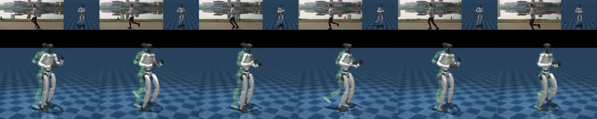

# Real athletes: free-licence video through the pipeline; no tracker passes its spec yet (2026-10-30)

**Question:** the stack was built on our own phone clips. Does it also work on video of other people, filmed by
someone else, that the submission may legally show? And can a move that travels (a run) be trained for when the G1 has
to do it on the spot?

**Short answer:**
- The front end, retarget, spec and variants work on all four clips.
- A run-in-place mode keeps the planted feet still (0.3–0.5 cm/s of slip) at the cost of knee fidelity.
- After 1,250 training iterations, none of the three trackers completes its clip's key moments at full speed; the
  kick doesn't fit the G1 as filmed.
- Nothing was added to the hosted demo.

Every number below is in `docs/results/real_athletes/`:

| File | What it holds |
|---|---|
| `audit.json` | the pipeline audit |
| `in_place_*.json` | the in-place measurements |
| `policies.json` | training and evaluations |
| `facts.json` | the rest: coverage, the intake's warnings, the kick, foot heights, job times. Written by `experiments/real_athletes.py facts` from the run logs and rollouts. |

## The clips

Licences were read on each clip's page on 2026-10-30. The record, with authors, page and file URLs, trims and the
credit lines, is `docs/real_athletes/clips.json`. The video files stay out of git.
- Pexels and Mixkit licences need no attribution. The site credits each clip anyway (`web.json` "credit", shown on the
  run and build pages and the showcase tab).
- These are stock-footage people (two runners, a kicker, a boxer), not famous professionals. Clean, openly licensed
  footage of famous athletes doing one move is close to nonexistent; broadcast footage is copyrighted.

Each clip was checked by eye on contact sheets for one person, full body, and no cuts:

| Clip | Source | Licence | Trim | Verdict |
|---|---|---|---|---|
| `jog_lakeside` | [Pavel Danilyuk, Pexels 4065467](https://www.pexels.com/video/a-man-wearing-sunglasses-running-in-the-street-4065467/) | Pexels License | 0–6.0 s | kept: side-on dolly shot of a jogger; a second runner enters at about 7 s |
| `jog_bridge` | [RDNE Stock project, Pexels 8402092](https://www.pexels.com/video/a-beautiful-woman-jogging-on-a-sunny-day-8402092/) | Pexels License | 0–7.5 s | kept: side-on jogger, slowly panning camera; a cut at about 8 s |
| `taekwondo_kick` | [rubenvelasco, Mixkit 49634](https://mixkit.co/free-stock-video/a-young-man-performs-a-karate-kick-to-the-air-49634/) | Mixkit Stock Video Free License | whole 6.4 s | kept: static camera, black background, a side kick |
| `shadow_boxing` | [Ron Lach, Pexels 8745108](https://www.pexels.com/video/woman-doing-shadow-boxing-8745108/) | Pexels License | 0–5.5 s | kept: backlit, the head briefly hidden by a foreground object |
| Pexels 7187054 / 7187058 (sprinters) | RDNE Stock project | Pexels License | | rejected: cuts every second or so; one runs toward the camera |
| Neymar's free kick (Commons) | Rodrigogomesonetwo | **CC BY-SA 4.0** (the file page's `{{self|cc-by-sa-4.0}}`), not CC BY | | excluded by licence, not downloaded |

**Gaps:**
- **Jogs, not a sprint.** The two side-on sprinter clips on the free sites have cuts every second or so.
- **No hurdle or high-jump approach.** The only ones under an allowed licence were vertical phone footage looking down
  the lane.

## Pipeline quality (the pipeline audit's numbers)

Processing ran on Modal (job `pro_ra`, an L40S, 12 minutes for all four): SAM 3.1, then SAM 3D Body, the camera
intake, and the retarget. The two jogs then had their retargets redone locally with the final in-place steps
(`experiments/real_athletes.py reretarget`).

Columns: coverage comes from `facts.json` "processing"; the rest from `audit.json`
(`experiments/real_athletes.py audit`).
- **IK error:** the mean distance between the G1's frames and their targets.
- **Angle error:** the mean flexion error to the human.
- **Limits:** the share of frames with any joint within 1° of a limit.
- **Variants kept:** of the 36 training variants, after the physical filter (`skill/variations.py`).

| Clip | SAM 3.1 visible | SAM 3D Body pose | IK error, knees / feet / hands (cm) | Angle error, knee / hip (°) | Fastest joint (rad/s) | Limits | Spec: key moments, self-check | Variants kept |
|---|---|---|---|---|---|---|---|---|
| `jog_lakeside` (in place) | 100% | 100% | 4.6–6.1 / 0.2–0.4 / 0.1 | 19.9 / 12.9 | 12.7 | 0% | 11, 12/12 | 36/36 |
| `jog_bridge` (in place) | 100% | 100% | 4.3–4.4 / 0.1 / 0.1 | 11.0 / 13.3 | 10.3 | 16% (ankle pitch) | 10, 11/11 | 35/36 |
| `shadow_boxing` | 99% | 100% | 1.0–1.5 / 0.0–0.1 / 0.1 | 3.8 / 3.6 | 13.4 | 5% | 3, 5/5 | 36/36 |
| `taekwondo_kick` | 100% | 100% | 2.0–5.4 / 0.3–1.2 / 0.1 | 12.0 / 9.0 | 20.0 (at the cap) | **67%** | 4, 6/6 | 24/36 |

The intake's warnings (`facts.json`):
- The bridge jogger is 383 px tall, under the 400 px it wants.
- On the kick, few frames register against the black background, so the camera was left uncompensated. That's right
  for this static camera.

The in-place jogs' knee and hip errors are the cost of running on the spot (see "Run in place" below), not pose error.
Travelling, the same clips retarget at 1.1° and 1.6° of knee error.

**The kick does not fit the G1 as filmed.**
- The reference pins the right hip yaw at its limit in 45% of frames, the hip pitch in 33% and the knee in 25%
  (`audit.json`). A side kick at hip height asks for more hip range than the G1 has.
- Its torso tilts to 1.386 rad (79°). The robustness eval's fall rule is 1.4 rad, which the reference trips itself, so
  the eval refuses to score it (`facts.json` "kick").
- Training agreed. After 1,000 iterations on Modal its episodes lasted 87 of 317 steps (50 Hz). They ended mostly on
  mjlab's end-effector height check: 47.8 `ee_body_pos` terminations per logging window, against 8.5 `anchor_pos`.
- A lower kick, or a front kick (as on our own clip), is what this robot can be trained for.

## Policies: they stay up but complete none of the clips

**Result: none of the three trackers passes its spec.**
- After training, each stays up: no falls on the clean clip, 0–2% under 1 m/s pushes.
- Each tracks its reference's torso within 3.5–7.2 cm.
- But at full speed none completes the spec's key moments in order. The jogs shuffle their feet instead of lifting them.
- The lakeside jog completes its two slowest held-out variants (half speed, and mirrored at 1.6x longer) in all 64
  rollouts of each.
- No run was added to the hosted demo.
- The demo wiring was run end to end on these runs and set aside (`outputs/_real_athletes_not_passing/`, outside the
  patterns `build_space.py` ships): `assemble --all`, `build_variants_view.py`, the API with its credit, and a showcase
  bundle.



**Recipe.** As for the squat jump:
- `tracking_var` trained on the clip's variants (`experiments/variant_policy.py`), one policy per clip.
- Warm-started from the squat-jump variants tracker (`remote_variants_s3_sj/policy_tracking_var/model_1499.pt`).
- Then the held-out variants and recorded pushes (`scripts/real_athletes.sh`, `remote_run.py athletes`).

**Training: 1,250 iterations in three pieces**, because the GPU budget ran out on the way. Each piece is a separate
warm start from the previous checkpoint (`--init`): the weights carry over, but the optimizer and the iteration counter
restart.
1. **Modal (L40S, 4,096 envs): 250 iterations kept.**
   - All four clips trained in parallel in one container. The workspace hit its billing-cycle spend limit and the
     container was stopped. Its training logs end at iterations 448 (lakeside), 489 (bridge) and 455 (boxing).
   - Checkpoints are every 250 iterations, so iteration 250 was kept. Further calls were refused.
   - The kick got further, to iteration 999. It had fewer variants to build (24, not 35–36), so it started training
     about 7 minutes earlier, and it ran faster: 1,000 iterations in 23.5 minutes against about 2.3 s per iteration for
     the others (`facts.json` "modal_training_before_the_limit"). Its rollout after training was cut off.
   - Before training, building the variants took about 30 minutes in the job: about 40 motion files per clip, four
     clips sharing 8 CPUs while the GPU idled. Build them beforehand next time (`variant_policy.py --build-only`, or
     the new `--reuse-build` and `real_athletes.sh --from`).
2. **This Mac's CPU (512 envs): 250 iterations, from the GPU iteration-250 checkpoint.**
   - mjlab runs on Warp's CPU backend with `CUDA_VISIBLE_DEVICES=` empty, at about 10 s per iteration.
   - Each iteration has an eighth of a GPU iteration's samples (512 envs, not 4,096).
   - The processes ended at iterations 551–591; the iteration-500 checkpoint was kept.
3. **Colab (one L4, 4,096 envs, job `athletes_ra5`): 750 iterations, from the CPU iteration-500 checkpoint.** The three
   clips ran in parallel, then the eval and the recorded pushes. The session stopped itself when the job ended.

So the final policies have 250 + 750 = 1,000 iterations at 4,096 envs and 250 at 512 envs in between: more than the
planned 1,000, but not a continuous run.

**Evaluation** (`experiments/robustness_eval.py`, no V-JEPA):
- "Stages" is the share of the spec's key moments done in order; success needs all of them.
- Held-out variants are tempos and amplitudes outside the training grid (`skill/variations.py` HELD_OUT). Only those
  that pass the physical filter are scored.
- Numbers are in `policies.json` "eval_final"; the final eval ran on the Colab GPU with 64 rollouts per condition.

| Clip | Clean: success / stages / falls | Torso error (m) | Joint error (rad) | 1 m/s pushes: success / falls | Held-out variants: success / falls |
|---|---|---|---|---|---|
| `jog_lakeside` (in place) | 0% / 17% / 0% | 0.053 | 0.145 | 0% / 2% | 29% / 0% over 7 variants (the half-speed and mirrored 1.6x ones: 100% each, the other 5: 0%) |
| `jog_bridge` (in place) | 0% / 18% / 0% | 0.035 | 0.116 | 0% / 0% | 0% / 0% over 5 variants (its filter dropped the mirrored 1.6x and the half-speed ones, so the two the lakeside policy passes weren't scored) |
| `shadow_boxing` | 0% / 21% / 0% | 0.072 | 0.146 | 2% / 0% | 4% / 0% over 7 variants |
| `taekwondo_kick` | not scorable: the reference itself trips the fall rule (above) | | | | |

**Joint error by training stage** (lakeside / bridge / boxing; `policies.json`). The first two rows were scored on CPU
with 32 rollouts per condition, the last on the Colab GPU with 64:

| After | Joint error (rad) |
|---|---|
| 250 GPU iterations | 0.258 / 0.208 / 0.210 |
| + 250 on CPU (512 envs) | 0.167 / 0.193 / 0.172 |
| + 750 on Colab | 0.145 / 0.116 / 0.146 |

For comparison, the squat-jump tracker that is the warm start scores 0.093 rad, with 100% clean and 82% held-out
success (`facts.json` "warm_start_squat_jump", from `outputs/remote_robust_s3_sj`).

**Where the jogs fail** (`facts.json` "jog_feet": the reference's ankles against the final policy's two saved clean
rollouts).
- The reference's ankles are above 18.0–19.9 cm (lakeside, right / left) and 17.6–18.7 cm (bridge) for 10% of the
  clip, with peaks of 20–25 cm.
- The policy's ankles sit at a median of 3.5–3.7 cm. They're above 5.6–7.0 cm for 10% of the clip on the lakeside, and
  3.5–3.6 cm on the bridge. It shuffles in place while tracking the trunk.
- So neither completes its second key moment:
  - lakeside: "left foot up, right foot forward", with a 5.9 cm left-foot-height tolerance;
  - bridge: "left foot up, right hand forward", with 4.3 cm.
  - Both ask for the left foot off the floor for 0.1 s.
- Slowed to half speed, the lakeside policy does every key moment.
- **Our reading, not tested:**
  - A run in place is a hard version of a jog. Its flights go straight up, with no forward momentum to carry the body,
    so a tracker may earn more by keeping its feet down than by risking the hop.
  - Under the tracking reward, which weights body positions, the feet are a small share of the error.
  - The fixes we'd try: more iterations in one continuous run; a foot-clearance term or the stage-weighted task reward
    (`taskhybrid_var`); or the half-speed variant as the clip.

**Where the boxing fails.** Its spec is footwork: a turn and steps back and to the side. On the clean clip the policy
tracks the body to 8–13 cm RMS (pelvis 8.1, hands 10.0–12.0, feet 10.0–13.1 cm; `facts.json`) without falling, but
doesn't complete those steps.

**Compute** (`facts.json` "job_times"):
- Modal: the processing job (22:37–22:50), and one training job from 23:00 until the spend limit stopped it.
- Colab: one L4 from 02:52 to 04:26.
- No other GPU.

**What the deploy needs, once a clip passes:**
1. `python3 experiments/real_athletes.py assemble outputs/remote_athletes_<tag>`. Only clips whose policy completes
   the clip become `outputs/remote_latent_ra_*` runs, with a `web.json` credit.
2. `python3 scripts/build_variants_view.py outputs/remote_latent_ra_*`
3. `python3 experiments/real_athletes.py showcase <clip>...`: the 3D bundle and a credited showcase tab. It refuses a
   run that doesn't pass.
4. Map the clip to its bundle in `web/src/buildview/data.ts` (`OWN`).
5. `scripts/build_space.py` ships `remote_latent_ra_*` runs whose `eval.json` says they pass, with their `robust.json`.
   Then the usual Space and Pages redeploy (`docs/DEPLOY.md`); the credit components are new in the web build.

## Run in place (`pipeline.py --in-place world`)

A run's reference travels several metres. The tracking tasks learn travel poorly (docs/FRONTIER_TRAVEL.md), and a
demo floor is finite. So `--in-place METHOD` turns the travelling motion into the same gait on the spot, keeping the vertical
root motion (the bounce, the flights) and the foot contacts.

It is an option of the retarget (`retarget.proportional_motion(in_place=...)`). It is passed through `pipeline.py`,
`experiments/process_clips.py`, `scripts/pro_clips.sh` (`IN_PLACE=`) and `scripts/remote_run.py --in-place`.
`experiments/real_athletes.py reretarget` redoes a stored clip's retarget without a GPU. The clip's `meta.json`
records it, for example the bridge jog:

```json
"in_place": {"method": "world", "travel_removed_m": 5.776, "mean_speed_m_s": 0.77, "stride_s": 1.333,
             "root_travel_left_m": 0.0, "floor_drift_removed_m": 0.303,
             "travel_restore": {"before_m": 6.596, "after_m": 5.776, "added_xy_m": [0.663, -3.674]}}
```

### Steps, in order

1. **Level the floor** (`level_floor`). A camera pitch error turns travel into height. On the bridge jog the floor
   rose 0.30 m over 7.5 s, so its second half had no foot near the floor: no contacts, and every variant was dropped,
   the clip itself included.
   - The fix: a line through the lowest foot's lowest point per 0.5 s, refitted without the windows more than 5 cm
     above it (flights), and applied only when at least 75% of the windows lie on it.
   - The hurdles film, which ends in a long flight, is left alone (`in_place_hurdles.json`: no drift removed).
2. **Make the root follow the planted feet** (`restore_travel`). While the lowest foot is on the floor, the root must
   move at minus that foot's velocity relative to it. Where the root's path differs, the difference, smoothed over
   1 s, is added if it averages over 0.3 m/s. It is a vector, so it can add missing travel or remove drift:
   - **Lakeside jog (a dolly shot):** its background is far away and barely moves, so the camera compensation
     recovers 0.23 m of travel. The pose reads as a treadmill run: in the travelling retarget the lowest sole moves at
     1.8 m/s while down, and the contact detector, which needs a planted foot to stand still, finds no contacts. The
     restore brings the travel to 5.90 m and the contacts back (stance 39% / 41% per foot).
   - **Bridge jog (a panning camera):** the root already travels 6.60 m, but partly sideways of where the feet go. The
     change, (+0.66, −3.67) m, mostly removes that drift, leaving 5.78 m. With the floor levelled, stance goes from
     24% / 21% to 51% / 46%.
   - **Hurdles:** 3.21 → 2.24 m.
   - Only with `--in-place`: the default retarget is unchanged.
3. **Find the contacts** on that travelling motion, where a planted foot stands still.
4. **Remove the travel**, by one of three methods:

| Method | What it does | What it costs |
|---|---|---|
| `world` (default) | The root is held where it starts. Each contact is pinned under it at the contact's mean position (`plant_feet(hold_root=True)`), and the pin is bridged across the swing. | The stance leg can't sweep back under a still hip, so it bends instead: knee angles differ from the human's. |
| `soft` | As `world`, but the root keeps its surge and sway within a stride. Each horizontal axis is squashed (tanh) into ±10 cm of a fixed centre (`IN_PLACE_SOFT_M`): a 20 cm band, so up to about 0.2 m from the start frame. | Measured below: it doesn't help. |
| `stride` | The planted motion minus its per-stride travel (a moving average of the root over one stride, `stride_drift`). | Every planted foot slides back at the running speed. |

### Measured

`experiments/in_place/measure.py` measures on the G1, from MuJoCo forward kinematics of the solved qpos. Results are
in `in_place_*.json`.
- **Slip:** a foot's horizontal speed on the frames the retarget plants it and its sole is within 2 cm of the floor.
- **Knee error:** the mean knee-angle error to the human.

The "travelling" rows are the default retarget, without steps 1–2. So for the bridge jog (whose travel and contacts
steps 1–2 change) they are not a like-for-like baseline. For the lakeside jog they show what the dolly shot does
without them.

| Clip | Method | Slip (cm/s) | Knee error (°) | Root's farthest from start (m) |
|---|---|---|---|---|
| Lakeside jog | travelling | n/a: no contacts found; the lowest sole moves at 179 while down | 1.1 | 0.40 |
| | **world** | **0.5** | 19.9 | 0.02 |
| | soft | 0.6 | 20.6 | 0.08 |
| | stride | 103 | 1.7 | 0.10 |
| Bridge jog | travelling | 0.1 | 1.6 | 6.62 |
| | **world** | **0.3** | 11.0 | 0.02 |
| | soft | 0.3 | 10.4 | 0.10 |
| | stride | 78 | 1.7 | 0.13 |
| Hurdles run-up (1900 film) | travelling | 0.0 | 1.3 | 3.17 |
| | **world** | **0.5** | 21.1 | 0.08 |
| | soft | 0.6 | 18.6 | 0.16 |
| | stride | 85 | 2.9 | 0.28 |

- **`world` keeps the feet planted.** `stride` slides them at about the speed it removed. So `world` is the default.
- **The cost is the knee:** 11–21° of mean knee-angle error, against 1–2° travelling. A stance leg that stays under the
  hip instead of sweeping behind it is a run in place, not a treadmill run. The arms, trunk and rhythm follow the
  person; the legs are the G1 jogging on the spot.
- **The soft hold doesn't buy the knee back.** It changes the knee error by −2.5 to +0.7° at the same slip, so `world`
  stays the default.

### Tests

`tests/test_in_place.py` uses a synthetic 2.5 m/s jog (0.6 s strides, 0.1 s flights). In place:
- the root holds, planted feet stay put, and the bounce is kept;
- `world` slips 0.6 cm/s against `stride`'s 192 (`facts.json` "synthetic_jog_slip");
- the soft hold stays within its band;
- a dolly-shot version (hips held still in the image) gets its travel and contacts back;
- a rising floor is levelled, and a flight at the clip's end isn't;
- the keypose spec compiles, and its own retarget completes it;
- the variant filter keeps the original and a mirrored and a re-timed variant.
